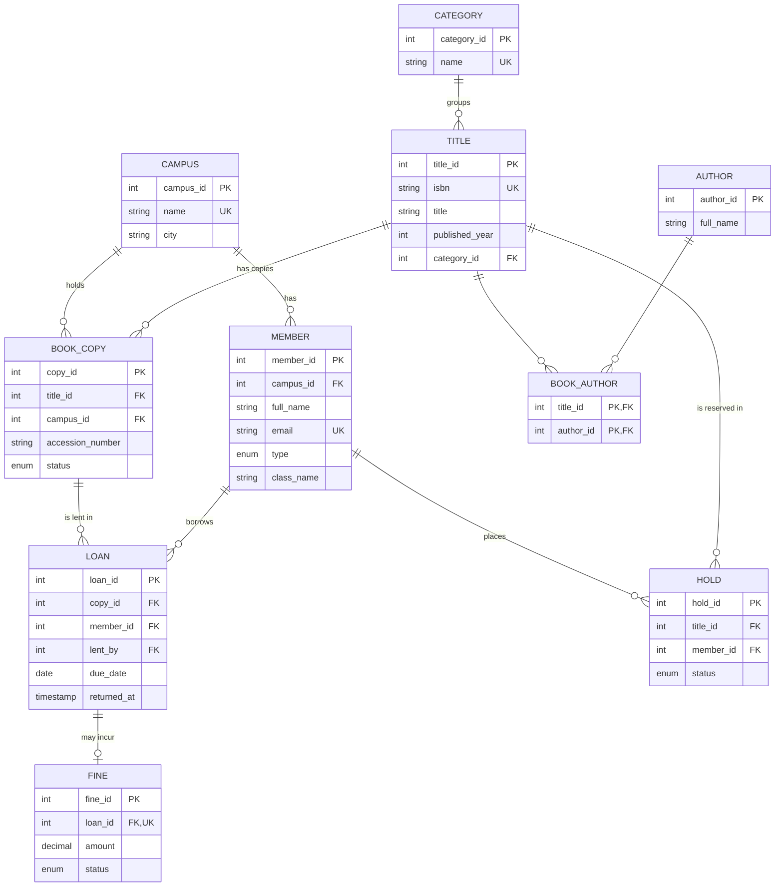
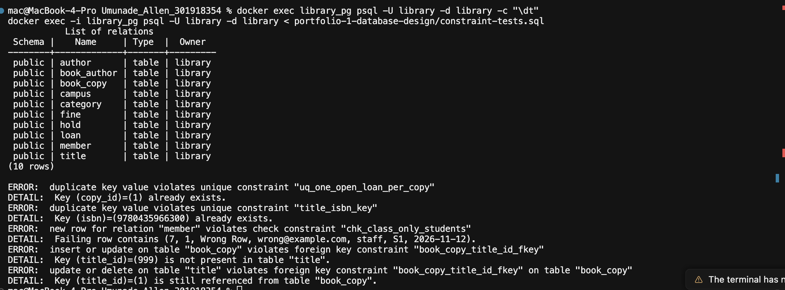

# Portfolio 1: Database Design and Modelling

## 1. Selected case study

**Organisation:** Naalya Schools Library Management System (a school with several campuses in Uganda, each running its own library). Used with the school's permission. The design is based on the library module of the Naalya school platform, simplified and rewritten for this course. All records in this repository are made-up sample data.

| Item | Description |
|------|-------------|
| Nature of the system | A multi-campus school library: cataloguing books, lending physical copies, reservations and fines |
| Database users | Librarians (run the desk), students and staff (borrow and reserve), school admin (reports) |
| Major data stored | Campuses, members, categories, titles, authors, physical copies, loans, holds (reservations), fines |
| Key operations | Add a title and its copies, borrow a copy, return a copy, reserve a title, charge and pay fines, search the catalogue, list overdue loans |

## 2. ER diagram



## 3. Relational schema

```
campus(campus_id PK, name UNIQUE, city)
member(member_id PK, campus_id FK→campus, full_name, email UNIQUE, type, class_name, joined_on)
category(category_id PK, name UNIQUE)
title(title_id PK, isbn UNIQUE, title, publisher, published_year, category_id FK→category)
author(author_id PK, full_name)
book_author(title_id FK→title, author_id FK→author, PK(title_id, author_id))
book_copy(copy_id PK, title_id FK→title, campus_id FK→campus, accession_number, shelf, status,
          UNIQUE(campus_id, accession_number))
loan(loan_id PK, copy_id FK→book_copy, member_id FK→member, lent_by FK→member,
     lent_at, due_date, returned_at)
hold(hold_id PK, title_id FK→title, member_id FK→member, status, requested_at, expires_at)
fine(fine_id PK, loan_id FK→loan UNIQUE, amount, reason, status, issued_at, paid_at)
```

Full SQL: [`schema.sql`](schema.sql). Sample data: [`seed.sql`](seed.sql).

## 4. Keys and constraints

| Constraint | Where | Business rule it enforces |
|-----------|-------|---------------------------|
| Primary keys (surrogate `SERIAL`) | every table | Each row has a stable identifier that never changes |
| Composite primary key | `book_author(title_id, author_id)` | An author is linked to a title only once |
| Unique | `member.email`, `title.isbn`, `category.name` | No duplicate members, books or categories |
| Composite unique | `book_copy(campus_id, accession_number)` | Accession numbers are unique within a campus |
| **Partial unique index** | `loan(copy_id) WHERE returned_at IS NULL` | A physical copy can only be on **one open loan** at a time |
| Partial unique index | `hold(title_id, member_id) WHERE status IN ('waiting','ready')` | A member cannot reserve the same title twice |
| Foreign keys with `RESTRICT` | `book_copy → title`, `loan → book_copy` | A book with history cannot be deleted by accident |
| Foreign keys with `CASCADE` | `book_author`, `hold`, `fine` | Link rows disappear with their parent |
| `CHECK` | `class_name` only for students; ISBN length 10 or 13; `due_date >= lent_at`; `amount > 0` | Invalid data is rejected by the database itself, not only by the app |
| Enum types | `member_type`, `copy_status`, `hold_status`, `fine_status` | Only known states are allowed |

[`constraint-tests.sql`](constraint-tests.sql) tries to break each rule; every statement is rejected (see the output screenshot).

## 5. Normalisation

Starting point: a single flat "library register" sheet, as many schools keep on paper:

`(accession_no, isbn, title, authors, category, campus, member_name, member_email, member_class, lent_date, due_date, returned_date, fine)`

- **1NF:** `authors` held several names in one cell (e.g. "Hugh Neill, Douglas Quadling"). These were moved to `author` and the link table `book_author`, so every cell holds one value and each row has a key.
- **2NF:** in the link table, the only attributes depend on the whole key `(title_id, author_id)`. Book details (title, publisher, year) depended on `isbn` only, not on the copy or the loan, so they moved to `title`.
- **3NF:** transitive dependencies were removed: `member_email → member_name, member_class` moved to `member`; `category_name` moved to `category`; `campus` details moved to `campus`; fine details depend on the loan, so they moved to `fine` (one fine per loan).
- **BCNF:** every determinant in each table is a candidate key (for example, in `book_copy` both `copy_id` and `(campus_id, accession_number)` are candidate keys).

**Deliberate design choice:** `book_copy.status` is kept even though "on loan" could be derived from the `loan` table. It makes "find a free copy" fast and is used in Portfolio 3 to show how a transaction keeps the two consistent.

## 6. How to run

```bash
docker compose up -d                       # starts PostgreSQL 16 on port 5433
docker exec -i library_pg psql -U library -d library < portfolio-1-database-design/schema.sql
docker exec -i library_pg psql -U library -d library < portfolio-1-database-design/seed.sql
docker exec -i library_pg psql -U library -d library < portfolio-1-database-design/constraint-tests.sql
```

## 7. Evidence



- [`evidence/tables.txt`](evidence/tables.txt): the list of tables (`\dt`)
- [`evidence/constraint-tests-output.txt`](evidence/constraint-tests-output.txt): each invalid insert being rejected by the database
