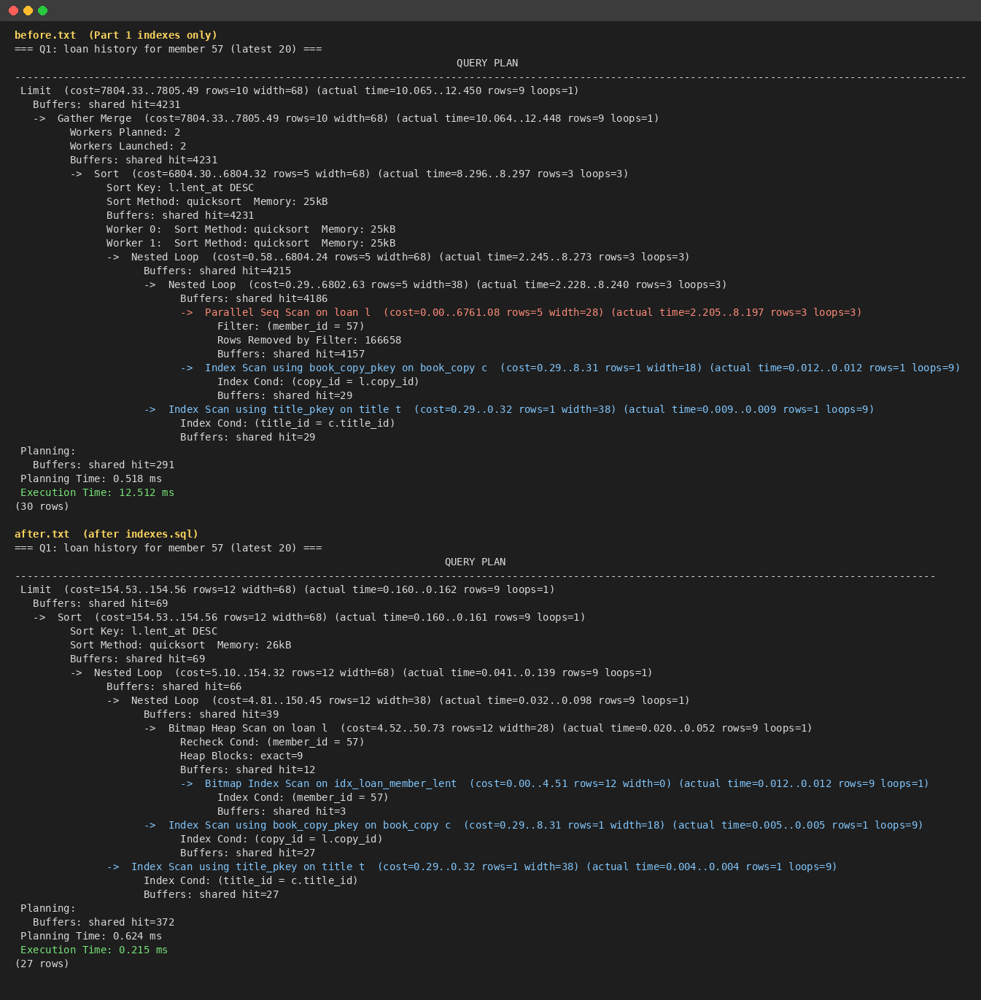
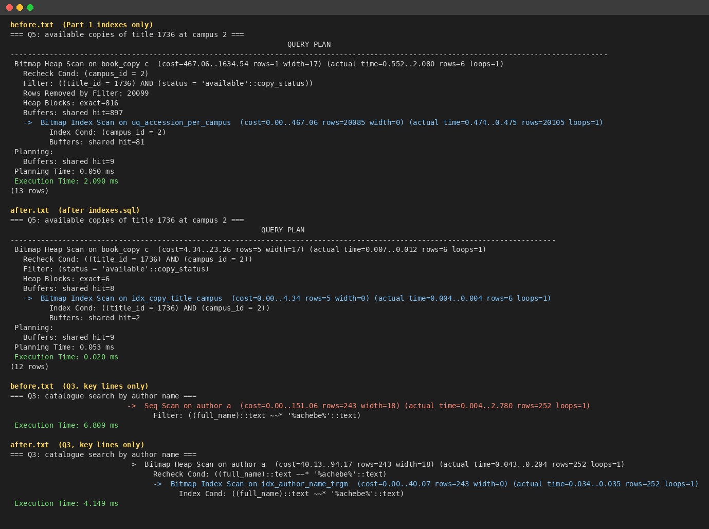
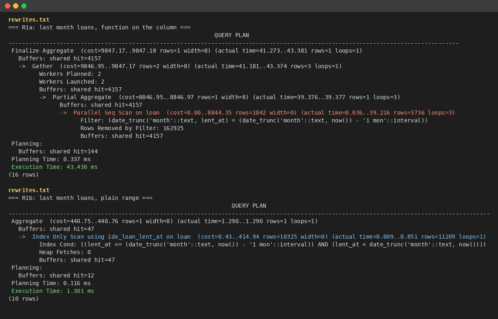
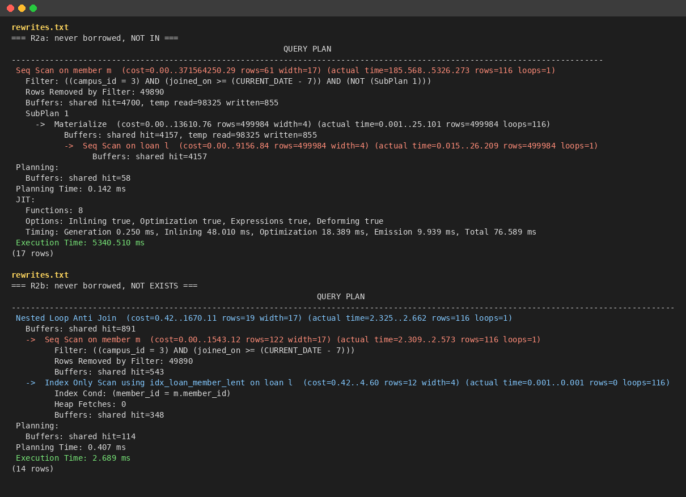

# Portfolio 2: Query Optimisation

## 1. Goal

Part 1 built the Naalya Schools library database. With only a few sample rows,
every query is fast, so it says nothing about performance. In this part I:

1. filled the database with a realistic amount of made-up data (a school group with
   5 campuses and several years of borrowing),
2. picked five queries the library actually needs every day,
3. measured them with `EXPLAIN (ANALYZE, BUFFERS)`,
4. added indexes aimed at those queries and measured again,
5. showed two cases where rewriting the SQL matters more than adding an index,
6. measured what the new indexes cost (slower inserts and extra disk space).

## 2. Files

| File | What it does |
|------|--------------|
| `bulk-data.sql` | Adds the test data with `generate_series()` and runs `VACUUM ANALYZE` |
| `queries-before.sql` | The five test queries with `EXPLAIN (ANALYZE, BUFFERS)`, before any new index |
| `indexes.sql` | Creates the new indexes and prints their sizes |
| `queries-after.sql` | Exactly the same five queries, run after `indexes.sql` |
| `rewrites.sql` | Two query rewrites (function on a column, `NOT IN` vs `NOT EXISTS`) |
| `write-cost.sql` | Times a 50,000 row insert into `loan`, then rolls it back |
| `evidence/` | Real output from my runs, the results table and screenshots |

## 3. Test data

All data is made up. Names come from short lists of common first names and surnames,
and every email is `memberN@example.com`. The random numbers use a fixed seed
(`setseed(0.42)`), so the same data comes out every time.

| Table | Rows |
|-------|-----:|
| campus | 5 |
| member | 50,006 |
| category | 20 |
| title | 20,004 |
| author | 8,005 |
| book_author | 23,977 |
| book_copy | 100,006 |
| loan | 499,984 (about 10,000 still out, about 4,000 overdue) |
| hold | 40,001 (about 4,000 still live) |
| fine | about 73,000 |

The data respects every rule from Part 1:

- **One open loan per copy:** the 490,000 old loans all have a `returned_at` date, so
  they never clash. The open loans are made from a list of different copies, so each copy
  gets at most one.
- **One live hold per member per title:** old holds are `fulfilled`, `cancelled` or
  `expired`. The live ones use `ON CONFLICT DO NOTHING`, which skips any random pair
  that would break the rule.
- **Dates:** every `due_date` is 14 days after `lent_at`, and every `returned_at` is after `lent_at`.
- **Copy status:** a copy with an open loan is set to `on_loan`.
- **Fines:** only late returns get a fine, at UGX 500 per late day (at most 20,000).
- The newest 5,000 members joined in the last 60 days and have not borrowed yet.

Dates are worked out from today's date, so the overdue numbers change a little from day to day.

On my test machine the whole `bulk-data.sql` took about 10 seconds
(see `evidence/bulk-data-output.txt`).

## 4. How to run

Run from the repository root with the Docker container from Part 1 running.
`bulk-data.sql` must start from a fresh Part 1 database, so reload the schema and seed first.

```bash
docker compose up -d
docker exec -i library_pg psql -U library -d library < portfolio-1-database-design/schema.sql
docker exec -i library_pg psql -U library -d library < portfolio-1-database-design/seed.sql
docker exec -i library_pg psql -U library -d library < portfolio-2-query-optimisation/bulk-data.sql

docker exec -i library_pg psql -U library -d library < portfolio-2-query-optimisation/queries-before.sql > before.txt
docker exec -i library_pg psql -U library -d library < portfolio-2-query-optimisation/write-cost.sql
docker exec -i library_pg psql -U library -d library < portfolio-2-query-optimisation/indexes.sql
docker exec -i library_pg psql -U library -d library < portfolio-2-query-optimisation/write-cost.sql
docker exec -i library_pg psql -U library -d library < portfolio-2-query-optimisation/queries-after.sql > after.txt
docker exec -i library_pg psql -U library -d library < portfolio-2-query-optimisation/rewrites.sql > rewrites.txt
```

Tip: run each query file once and throw the result away, then run it again for the real
numbers. The first run is slower because the data is still being read from disk into memory.

## 5. The five queries

| Query | Question it answers | Who uses it |
|-------|---------------------|-------------|
| Q1 | What has member 57 borrowed recently? (latest 20 loans) | Librarian at the desk |
| Q2 | How many books are overdue at each campus, and how much is owed? | School admin report |
| Q3 | Which titles do we have by an author whose name contains "achebe"? | Anyone searching the catalogue |
| Q4 | What are the 10 most borrowed titles in the last 90 days? | Librarian buying new copies |
| Q5 | Is there a free copy of title 1736 at campus 2 right now? | Student or librarian |

## 6. Results

Times are the "Execution Time" from `EXPLAIN ANALYZE`, median of 5 warm runs, in milliseconds.
The full table, with raw times, is in [`evidence/results.md`](evidence/results.md).

| Query | Before (ms) | After (ms) | Change | Plan before | Plan after |
|-------|------------:|-----------:|-------:|-------------|------------|
| Q1 | 9.87 | 0.20 | about 51x faster | Parallel Seq Scan on loan | Bitmap Index Scan on idx_loan_member_lent |
| Q2 | 13.34 | 12.82 | almost no change | Bitmap scan on uq_one_open_loan_per_copy (from Part 1) | Index Only Scan on idx_loan_open_due |
| Q3 | 6.77 | 4.07 | about 1.7x faster | Seq Scan on author | Bitmap Index Scan on idx_author_name_trgm |
| Q4 | 56.80 | 44.72 | about 1.3x faster | Parallel Seq Scan on loan | Index Only Scan on idx_loan_lent_at |
| Q5 | 2.06 | 0.021 | about 98x faster | Bitmap scan of all 20,105 copies at campus 2 | Bitmap Index Scan on idx_copy_title_campus (6 copies) |

Each query returned exactly the same rows before and after, so only the speed changed.





## 7. Why each index helps

| Index | Type | Query | Why |
|-------|------|-------|-----|
| `idx_loan_member_lent` on `loan (member_id, lent_at DESC)` | B-tree, two columns | Q1, R2 | PostgreSQL does not index foreign keys by itself, so before this it read all 500,000 loans to find one member's 9. Now it jumps straight to that member. Putting `lent_at` second keeps each member's loans in date order. |
| `idx_loan_open_due` on `loan (due_date) INCLUDE (copy_id) WHERE returned_at IS NULL` | Partial, covering | Q2 | Only open loans (about 2% of the table) go in, so it is only 240 kB. `INCLUDE (copy_id)` lets the query read everything from the index (Index Only Scan). |
| `idx_author_name_trgm` on `author USING gin (full_name gin_trgm_ops)` | GIN trigram (`pg_trgm`) | Q3 | A normal B-tree index is no use for `ILIKE '%achebe%'` because the text starts with `%`. A trigram index breaks names into 3-letter pieces, so it can find a match anywhere in the name. |
| `idx_book_author_author` on `book_author (author_id)` | B-tree | Q3 | The primary key is `(title_id, author_id)`, which only helps when you know the title first. This one helps going from author to titles, and when an author is deleted (`ON DELETE CASCADE`). |
| `idx_loan_lent_at` on `loan (lent_at) INCLUDE (copy_id)` | B-tree, covering | Q4, R1 | The last 90 days are only about 8% of all loans. The index finds them directly and, with `copy_id` included, never has to touch the table. |
| `idx_copy_title_campus` on `book_copy (title_id, campus_id)` | B-tree, two columns | Q5 | Before, the best it could do was read every copy at campus 2 (about 20,000) and throw most away. Now it goes straight to the 6 copies of that title at that campus. It also covers the `title_id` foreign key. |

None of these repeat an index from Part 1. The existing ones (primary keys, unique keys,
`uq_one_open_loan_per_copy` and `uq_one_live_hold`) were left as they are.

### What did not improve much, and why

- **Q2 barely changed.** The partial unique index from Part 1 (`uq_one_open_loan_per_copy`)
  already only holds open loans, so PostgreSQL was already using it to find them quickly.
  Most of the time goes on reading all 100,000 rows of `book_copy` to find each copy's campus,
  and no index on `loan` can fix that. This was a useful lesson: a good constraint index
  can already be doing the job.
- **Q3 and Q4 only improved a little.** The filter part got much faster, but most of the time
  is spent joining and grouping the rows that are found (for Q4, about 37,000 loans joined to
  100,000 copies). In Q3 PostgreSQL still chose to read the small `book_author` table in full
  (about 24,000 rows) instead of using `idx_book_author_author`, because for 774 rows that
  was cheaper.

## 8. Query rewriting

Indexes only help if the query is written so PostgreSQL can use them. Both tests were run
after `indexes.sql`. Output is in `evidence/rewrites.txt`.

**R1. Do not wrap the column in a function.** Counting loans from last month:

```sql
-- A: slow (43.43 ms), Parallel Seq Scan
WHERE date_trunc('month', lent_at) = date_trunc('month', now()) - interval '1 month'
-- B: fast (1.30 ms), Index Only Scan on idx_loan_lent_at
WHERE lent_at >= date_trunc('month', now()) - interval '1 month'
  AND lent_at <  date_trunc('month', now())
```

The index stores `lent_at`, not `date_trunc('month', lent_at)`, so version A cannot use it.
Version B asks the same question as a plain range.



**R2. Use NOT EXISTS instead of NOT IN.** Finding new members at campus 3 (joined in the
last 7 days) who have never borrowed:

```sql
-- A: very slow (5,340.51 ms)
AND m.member_id NOT IN (SELECT l.member_id FROM loan l)
-- B: fast (2.69 ms)
AND NOT EXISTS (SELECT 1 FROM loan l WHERE l.member_id = m.member_id)
```

Both return the same 116 members. `NOT IN` has a special rule for NULL values, so PostgreSQL
cannot turn it into an anti join. The list of 500,000 loans is too big to keep in memory as a
hash (work_mem is 4 MB), so it re-reads the whole list for every member. `NOT EXISTS` becomes a
"Nested Loop Anti Join" that checks each member with one quick look in `idx_loan_member_lent`.



## 9. The cost of indexes (trade-off)

Indexes are not free:

- **Slower writes.** Every insert, update or delete on a table must also update each index
  on it. `write-cost.sql` inserted 50,000 loans and rolled them back. With the three new
  indexes on `loan` it took about 16% longer (median 581.30 ms before, 677.10 ms after).
  For a library this is fine: a desk records a few hundred loans a day but searches far more often.
- **More disk space.** The two full indexes on `loan` are 15 MB each, while the loan table is
  32 MB. All indexes on `loan` together now take 45 MB, more than the table. The partial index
  is only 240 kB because it holds only open loans, which is a good reason to use partial
  indexes when a query only needs a small part of a table.
- **More upkeep.** Indexes need `VACUUM` and `ANALYZE` like tables. An index nobody uses should
  be dropped; `pg_stat_user_indexes.idx_scan` shows how often each one is used.

## 10. Evidence

| File | Contents |
|------|----------|
| [`evidence/bulk-data-output.txt`](evidence/bulk-data-output.txt) | Output and timings of `bulk-data.sql`, with row counts |
| [`evidence/before.txt`](evidence/before.txt) | Full plans for Q1 to Q5 before the new indexes |
| [`evidence/indexes-output.txt`](evidence/indexes-output.txt) | Index creation times and sizes |
| [`evidence/after.txt`](evidence/after.txt) | Full plans for Q1 to Q5 after the new indexes |
| [`evidence/rewrites.txt`](evidence/rewrites.txt) | Full plans for R1 and R2 |
| [`evidence/timing-runs-before.txt`](evidence/timing-runs-before.txt), [`evidence/timing-runs-after.txt`](evidence/timing-runs-after.txt) | 5 timed runs of each query |
| [`evidence/write-cost-before.txt`](evidence/write-cost-before.txt), [`evidence/write-cost-after.txt`](evidence/write-cost-after.txt) | Insert timings without and with the new indexes |
| [`evidence/results.md`](evidence/results.md) | All the result tables |

**Note on timings:** these numbers were measured on a test machine running PostgreSQL 16.16
with default settings. On my laptop in Docker the times will differ a little, and they also
change slightly from run to run, but the plan changes (Seq Scan to Index Scan and so on) and
the rough size of each speed-up should be the same.
