# Portfolio 3: Transactions and Concurrency

## 1. Goal

A school library has several librarians and cashiers working at the same time.
Two of them can try to lend the last copy of a book in the same second, or take
a fine payment on the same fine. This part shows how PostgreSQL transactions keep
the Naalya library data correct when that happens.

It uses the Part 1 schema and the small Part 1 seed data (no bulk data needed),
so every result is easy to check by eye.

## 2. Files

| File | What it does |
|------|--------------|
| `borrow-function.sql` | `borrow_copy(copy, member, librarian)`: locks the copy, checks it is available, inserts the loan and marks the copy `on_loan`, all inside one transaction |
| `transactions.sql` | One session: COMMIT, ROLLBACK, the function, SAVEPOINT and constraint checks (A1 to A5) |
| `durability-check.sql` | Run after the server has been killed and restarted, to show committed loans survive |
| `concurrency/dN-...-a.sql` and `-b.sql` | Nine two-session demos. File `a` is Window A, file `b` is Window B |
| `run-demos.sh` | Runs everything and saves the output in `evidence/` |
| `evidence/` | Real output of every demo and screenshots |

Seed data used (from Part 1):

| Copy | Title | Campus | Status at start |
|-----:|-------|--------|-----------------|
| 1 | Biology for Secondary Schools | Main | on loan to member 2 |
| 2 | Biology for Secondary Schools | Main | available |
| 3 | Things Fall Apart | Main | on loan to member 3 |
| 4 | Core Mathematics | Main | available |
| 5 | A History of East Africa | Lugazi | available (the **only** copy of this title) |
| 6 | Things Fall Apart | Lugazi | available |

Members 1 and 5 are librarians, 2, 3 and 6 are students, 4 is staff. Fine 1 is UGX 3,000.

## 3. How to run

### Option 1: run everything with one command

From the repository root, with the Docker container running:

```bash
docker compose up -d
bash portfolio-3-transactions-concurrency/run-demos.sh
```

The script reloads the Part 1 schema and seed before each demo, so the demos never affect
each other. It takes about 30 seconds. **Note:** for the durability test it runs
`docker kill library_pg` and then `docker start library_pg` to simulate a crash. The data is
kept in the Docker volume, so nothing is lost.

For the two-session demos the script starts Window A and Window B at the same time in the
background. The `\! sleep` lines in the `.sql` files make each step happen at a fixed second
(shown as `[0s]`, `[1s]`, ... in the output), so the run is the same every time.

### Option 2: two Terminal windows by hand (for screenshots)

1. Reset the database (run in any Terminal, from the repository root):

   ```bash
   docker exec -i library_pg psql -U library -d library < portfolio-1-database-design/schema.sql
   docker exec -i library_pg psql -U library -d library < portfolio-1-database-design/seed.sql
   docker exec -i library_pg psql -U library -d library < portfolio-3-transactions-concurrency/borrow-function.sql
   ```

2. Open **two** Terminal windows side by side. In both, start psql:

   ```bash
   docker exec -it library_pg psql -U library -d library
   ```

   Call the left one Window A and the right one Window B.

3. Open the demo's `-a.sql` and `-b.sql` files. Copy the lines one step at a time, in the
   order of the `[0s]`, `[1s]`, `[2s]` labels: step 0s goes in A, 1s in B, 2s in A, and so on.
   You can skip the `\! sleep` lines, because you are doing the waiting yourself.
4. When a window "freezes" after a statement, that is the lock: it is waiting for the other
   window. Go to the other window and do its next step; the frozen one carries on by itself.
5. Reset the database (step 1) before each new demo.

The step tables in section 6 show exactly what to type in each window.

## 4. Part A: transactions in one session (`transactions.sql`)

Output: [`evidence/transactions.txt`](evidence/transactions.txt)

| Demo | What happens | Result |
|------|--------------|--------|
| A1 COMMIT | Member 4 borrows copy 2: lock the copy, insert the loan, mark the copy `on_loan`, `COMMIT` | Loan 4 saved and copy 2 is `on_loan` |
| A2 ROLLBACK | Member 6 borrows copy 6 and copy 1 in one transaction. Copy 1 is already out, so the second insert fails with `duplicate key value violates unique constraint "uq_one_open_loan_per_copy"` | After `ROLLBACK`, copy 6 is still `available` and member 6 has 0 loans: the first, successful insert was undone too |
| A3 function | The same with `borrow_copy()` | It stops with `copy 1 is not available (status: on_loan)` and the transaction is rolled back |
| A4 SAVEPOINT | Borrow copy 6, `SAVEPOINT second_book`, try copy 3 (fails), `ROLLBACK TO SAVEPOINT second_book`, borrow copy 4, `COMMIT` | Member 6 has copies 6 and 4; only the failed step was undone |
| A5 constraints | Due date before the lend date, a negative fine, a loan for member 999 | All three are refused (two CHECK constraints and a foreign key); nothing changes |

After an error inside a transaction, PostgreSQL answers every other command with
`current transaction is aborted, commands ignored until end of transaction block` until you
`ROLLBACK`. This is what stops a half-finished loan from being committed by mistake.

A small detail: loan ids 5, 6 and 7 were used by the rolled-back attempts and are never used
again. Sequences are not rolled back, so gaps in ids are normal.

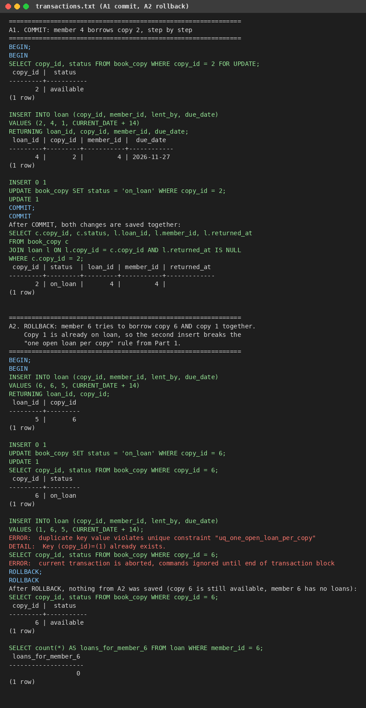

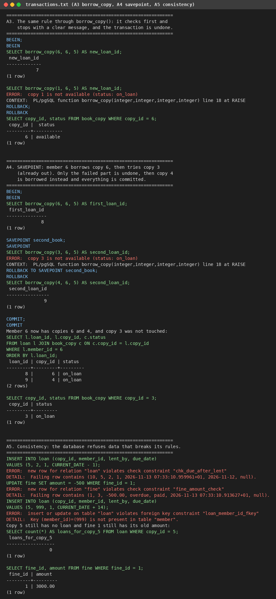

### Durability

After `transactions.sql`, the script kills the server (`docker kill`, like pulling the plug)
and starts it again. The server log shows `database system was not properly shut down;
automatic recovery in progress`, then `redo done`: PostgreSQL replays its write-ahead log (WAL).
`durability-check.sql` then shows loans 4, 8 and 9 (from A1 and A4) are still there.

Output: [`evidence/durability-server-log.txt`](evidence/durability-server-log.txt),
[`evidence/durability.txt`](evidence/durability.txt)

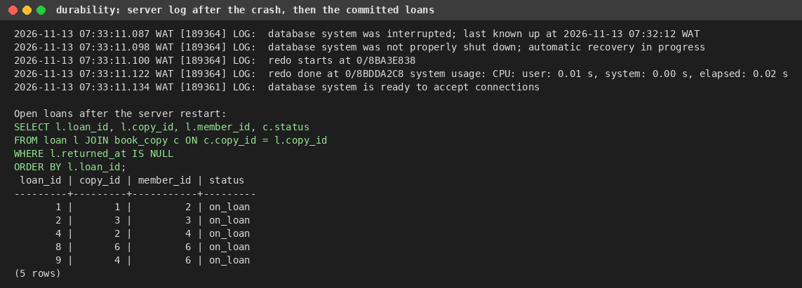

## 5. ACID with these demos

| Property | Meaning in plain words | Where it is shown |
|----------|------------------------|-------------------|
| **Atomicity** | All steps of a transaction happen, or none do | A2 and A3: the loan for copy 6 was undone when copy 1 failed. A4: a savepoint undoes only part of the work |
| **Consistency** | A transaction can only move the database from one valid state to another | A5: CHECK and foreign key constraints refuse bad data. Demo 3: the partial unique index refuses a second open loan |
| **Isolation** | Transactions running at the same time do not see each other's unfinished work, and the isolation level controls how much they see of each other's finished work | Demos 1 to 9 |
| **Durability** | Once COMMIT returns, the change survives a crash | The durability test: loans survive `docker kill` |

## 6. Part B: two sessions at the same time

PostgreSQL has three isolation levels that behave differently (READ UNCOMMITTED is treated
as READ COMMITTED):

- **READ COMMITTED** (the default): each statement sees everything committed before *that
  statement* started.
- **REPEATABLE READ**: the whole transaction sees the data as it was when the transaction
  took its first snapshot. If it tries to change a row someone else changed since, it gets an error.
- **SERIALIZABLE**: like REPEATABLE READ, but PostgreSQL also checks that the result is the same
  as if the transactions had run one after the other; if not, one fails with SQLSTATE `40001`.

### Demo 1 and 2: non-repeatable read

| Time | Window A | Window B |
|------|----------|----------|
| 0s | `BEGIN ISOLATION LEVEL READ COMMITTED;` (Demo 2: `REPEATABLE READ`) then `SELECT copy_id, status FROM book_copy WHERE copy_id = 5;` | |
| 1s | | `UPDATE book_copy SET status = 'damaged' WHERE copy_id = 5;` |
| 2s | the same `SELECT` again, then `COMMIT;` | |

| Level | First read | Second read (same transaction) |
|-------|-----------|-------------------------------|
| READ COMMITTED | available | **damaged** (non-repeatable read) |
| REPEATABLE READ | available | available (the change is seen only after `COMMIT`) |

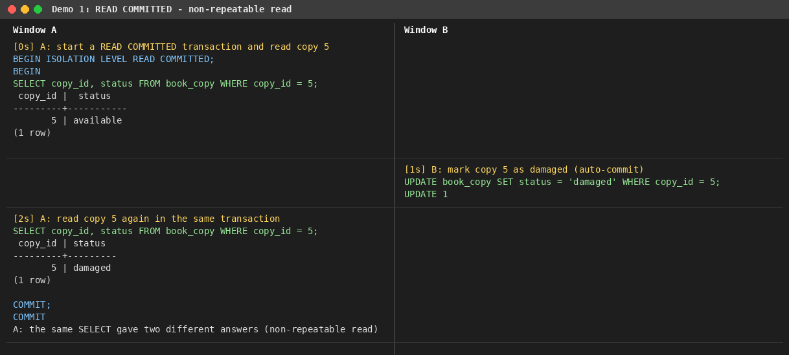
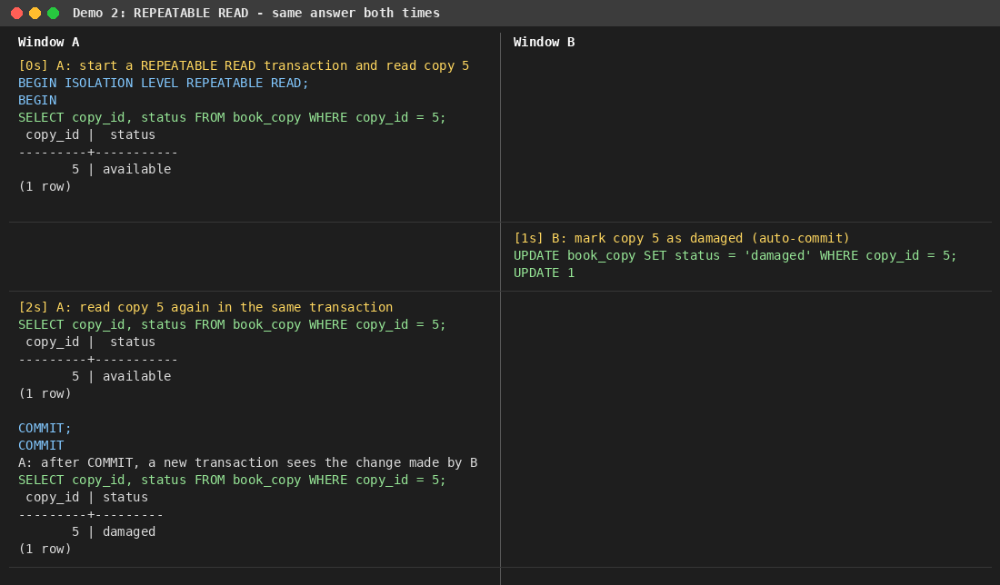

### Demo 3, 4 and 5: two librarians lend the last copy

Copy 5 is the only copy of "A History of East Africa". Librarian 5 (Window A) lends it to
member 6, and librarian 1 (Window B) tries to lend it to member 4 at the same time. Both check
it first and both see `available`. Without protection, the book would be lent twice.

**Demo 3, plain check (no lock), READ COMMITTED.**

| Time | Window A | Window B |
|------|----------|----------|
| 0s | `BEGIN;` `SELECT ... WHERE copy_id = 5;` → available | |
| 1s | | `BEGIN;` `SELECT ... WHERE copy_id = 5;` → available |
| 2s | `INSERT INTO loan ... (5, 6, 5, ...);` `UPDATE book_copy SET status = 'on_loan' ...;` | |
| 3s | | `INSERT INTO loan ... (5, 4, 1, ...);` → **waits** |
| 4s | `COMMIT;` | the wait ends: `ERROR: duplicate key value violates unique constraint "uq_one_open_loan_per_copy"` (waited 1000.5 ms), then `ROLLBACK;` |

Result: copy 5 has exactly one open loan. The partial unique index from Part 1 saved us, but
B only found out with an error at the very end.

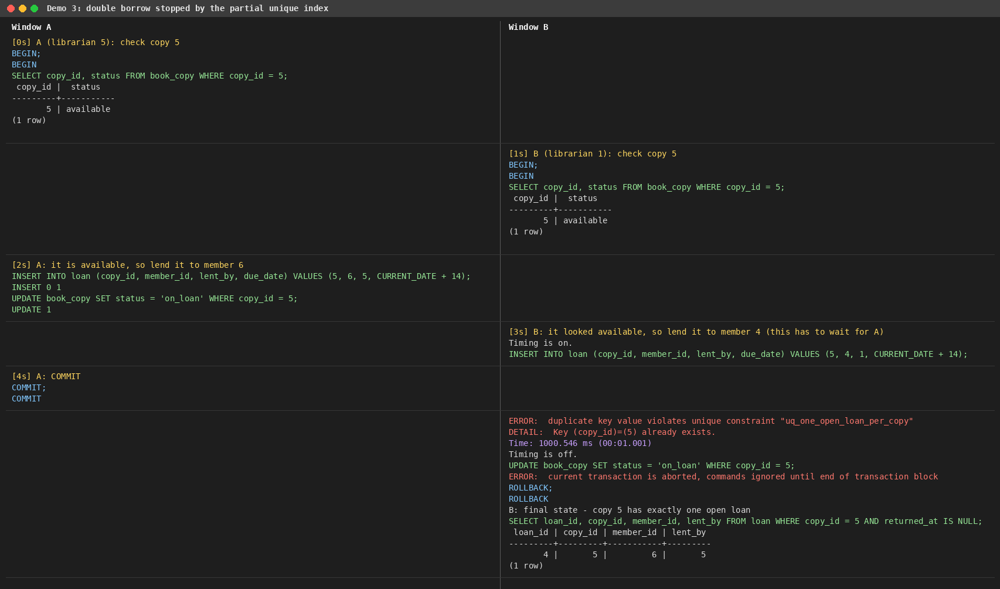

**Demo 4, `SELECT ... FOR UPDATE`.** Each librarian locks the copy row before checking it.

| Time | Window A | Window B |
|------|----------|----------|
| 0s | `BEGIN;` `SELECT ... WHERE copy_id = 5 FOR UPDATE;` → available | |
| 1s | | `BEGIN;` `SELECT ... WHERE copy_id = 5 FOR UPDATE;` → **waits** |
| 2s | `INSERT INTO loan ...;` `UPDATE book_copy ...;` | |
| 3s | `COMMIT;` | the wait ends (2004 ms) and B sees **on_loan**, so B does not lend it: `ROLLBACK;` |

Result: no error and no double loan. B simply sees the true status. `borrow_copy()` works the
same way and then says `copy 5 is not available (status: on_loan)`.

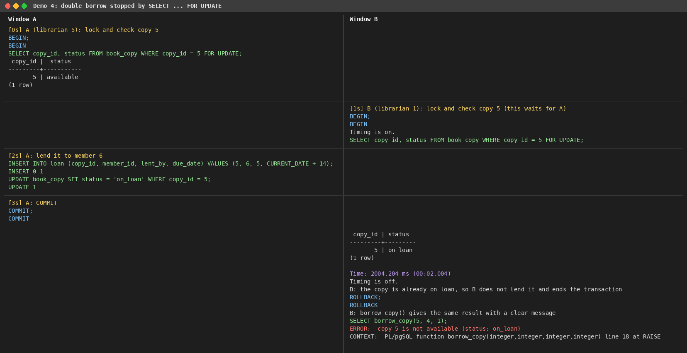

**Demo 5, SERIALIZABLE, no locks.**

| Time | Window A | Window B |
|------|----------|----------|
| 0s | `BEGIN ISOLATION LEVEL SERIALIZABLE;` `SELECT ...` → available | |
| 1s | | `BEGIN ISOLATION LEVEL SERIALIZABLE;` `SELECT ...` → available |
| 2s | `UPDATE book_copy SET status = 'on_loan' ...;` `INSERT INTO loan ...;` | |
| 3s | `COMMIT;` | |
| 4s | | `UPDATE book_copy SET status = 'on_loan' ...;` → `ERROR: 40001: could not serialize access due to concurrent update`, then `ROLLBACK;` and retry: the new transaction sees **on_loan** |

Result: B's transaction is refused because it was based on old data. An application using
SERIALIZABLE must catch error 40001 and run the transaction again.

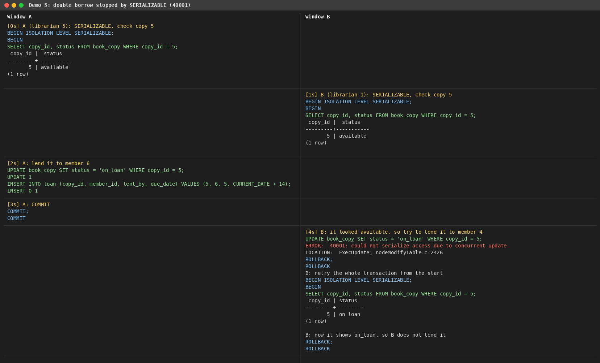

| Protection | What B experiences | Good for |
|------------|-------------------|----------|
| Partial unique index (Demo 3) | Error at insert time | Last line of defence, always on |
| `FOR UPDATE` (Demo 4) | Waits, then sees the real status | Normal "check then change" work like borrowing; used in `borrow_copy()` |
| SERIALIZABLE (Demo 5) | Error 40001, must retry | Complex transactions where it is hard to know which rows to lock |

### Demo 6 and 7: lost update on a fine

Fine 1 is UGX 3,000. Cashier A takes 1,000 and cashier B takes 500, at the same time, so
1,500 should be left.

| Time | Window A | Window B |
|------|----------|----------|
| 1s | `BEGIN;` `SELECT amount ...` → 3000 | |
| 2s | | `BEGIN;` `SELECT amount ...` → 3000 |
| 3s | `UPDATE fine SET amount = 2000 ...;` (3000 - 1000) | |
| 4s | | `UPDATE fine SET amount = 2500 ...;` (3000 - 500) → **waits** |
| 5s | `COMMIT;` | the wait ends (1004.3 ms), `COMMIT;` |

Result (Demo 6): the fine is **2,500**. A's payment of 1,000 was lost, because B wrote back a
number it worked out from an old reading.

Demo 7 does the same two payments as `UPDATE fine SET amount = amount - 1000` and
`amount = amount - 500`. B waits for A's row lock and then subtracts from the new value.
Result: **1,500**, both payments counted. (Locking the row with `SELECT ... FOR UPDATE` before
reading, or using REPEATABLE READ and retrying on error, would also fix it.)

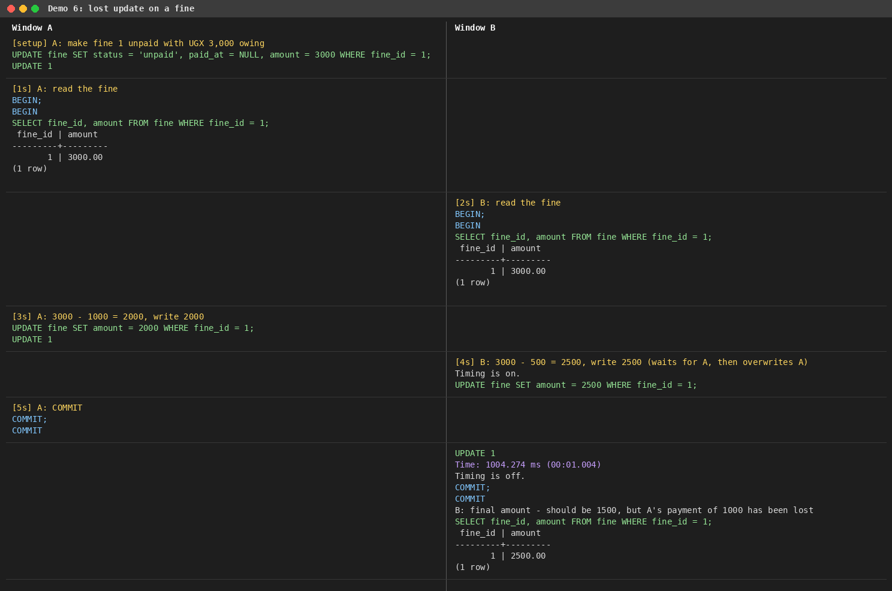
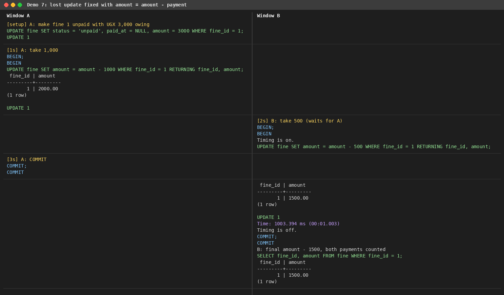

### Demo 8 and 9: deadlock

Two librarians re-shelve copies 2 and 4, in opposite order.

| Time | Window A | Window B |
|------|----------|----------|
| 0s | `BEGIN;` `UPDATE book_copy SET shelf = 'R1' WHERE copy_id = 2;` | |
| 1s | | `BEGIN;` `UPDATE book_copy SET shelf = 'R2' WHERE copy_id = 4;` |
| 2s | `UPDATE ... WHERE copy_id = 4;` → waits for B | |
| 2.5s | | `UPDATE ... WHERE copy_id = 2;` → waits for A (deadlock) |
| 3s | `ERROR: 40P01: deadlock detected` and A is rolled back | the wait ends (497 ms), `COMMIT;` |

Each window waits for the other, so neither could ever finish. PostgreSQL checks for this
after `deadlock_timeout` (1 second by default), picks one transaction (here A) and cancels it so
the other can finish. A's later `COMMIT` only prints `ROLLBACK`.

Demo 9 is the fix: both windows lock the copies they need at the start, always in the same
order: `SELECT copy_id FROM book_copy WHERE copy_id IN (2, 4) ORDER BY copy_id FOR UPDATE;`.
B just waits about 1 second for A, then finishes. No deadlock.

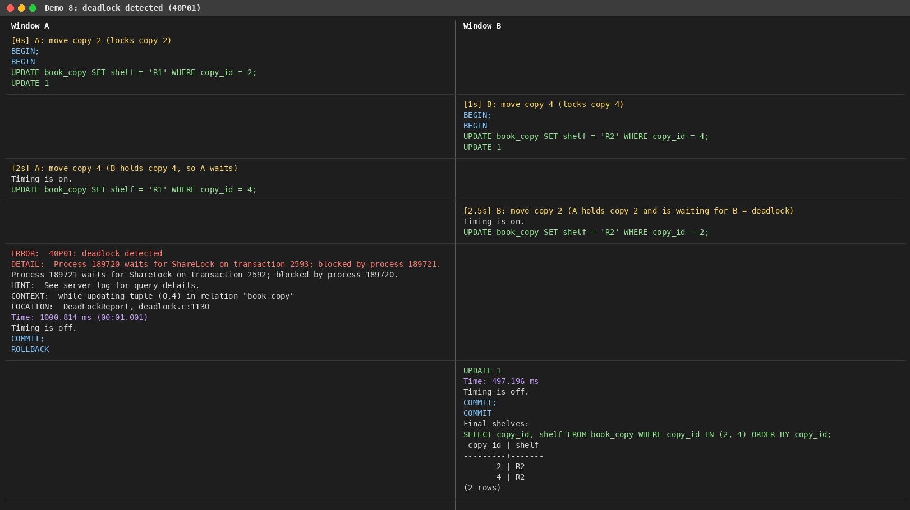
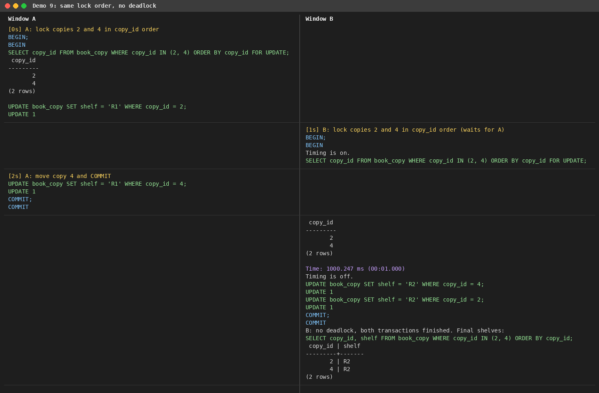

## 7. Summary of results

| Demo | Problem | Result |
|------|---------|--------|
| A1 | Borrow a book | Loan and status change committed together |
| A2, A3 | One step fails | Whole transaction rolled back, nothing partial saved |
| A4 | Part of the work fails | Savepoint undoes only that part |
| A5 | Bad data | Refused by CHECK and foreign key constraints |
| Durability | Server killed | Committed loans still there after recovery |
| 1 | Non-repeatable read | Happens in READ COMMITTED |
| 2 | Non-repeatable read | Prevented by REPEATABLE READ |
| 3 | Double borrow | Stopped by the partial unique index (error) |
| 4 | Double borrow | Prevented by `FOR UPDATE` (B waits, sees on_loan) |
| 5 | Double borrow | Stopped by SERIALIZABLE (error 40001, retry) |
| 6 | Lost update | 2,500 instead of 1,500 |
| 7 | Lost update | Fixed with `amount = amount - payment`: 1,500 |
| 8 | Deadlock | Detected by PostgreSQL (40P01), one transaction cancelled |
| 9 | Deadlock | Avoided by locking in the same order |

**Recommended pattern:** the default READ COMMITTED level does not stop every problem on its own.
For the library, the safe pattern for borrowing is to lock the copy (`FOR UPDATE`) inside a
transaction, as `borrow_copy()` does, and to keep the partial unique index as a safety net.
For money, let the database do the sum in one `UPDATE`.

The wait times (about 1 or 2 seconds) come from the `sleep` steps in the scripts, not from
PostgreSQL being slow. They were measured on a test machine running PostgreSQL 16.16 and will
be almost the same on my laptop, but the process numbers and timestamps in the output will differ.
