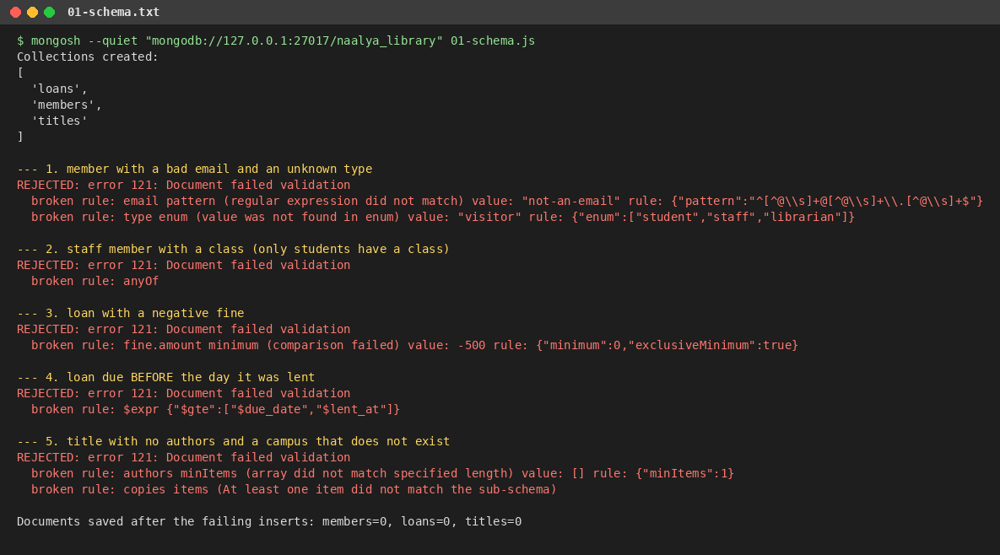
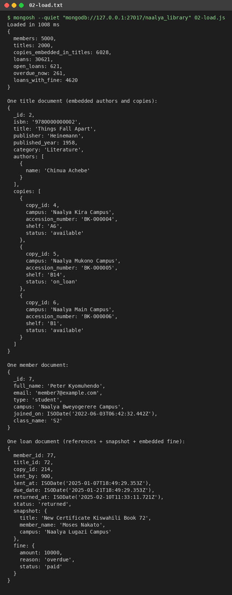
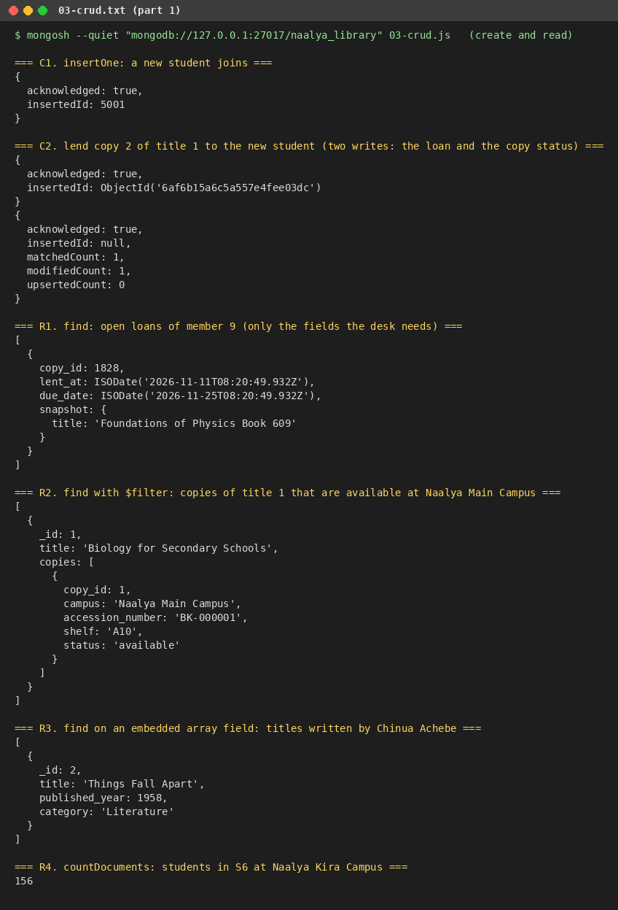
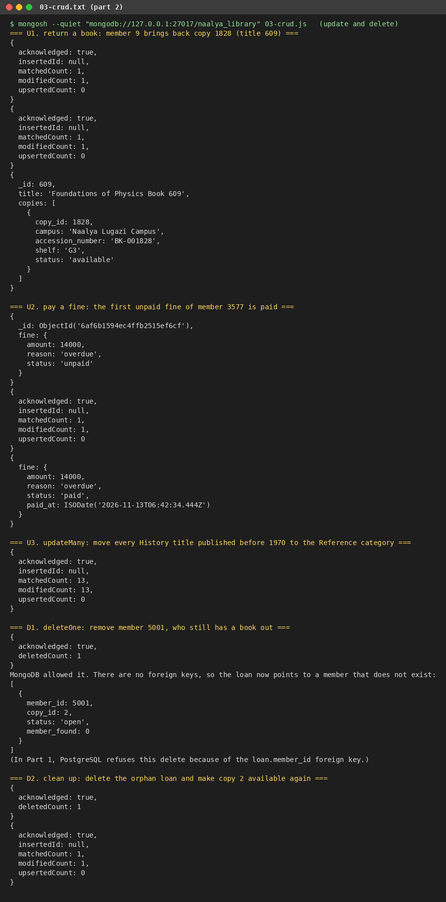
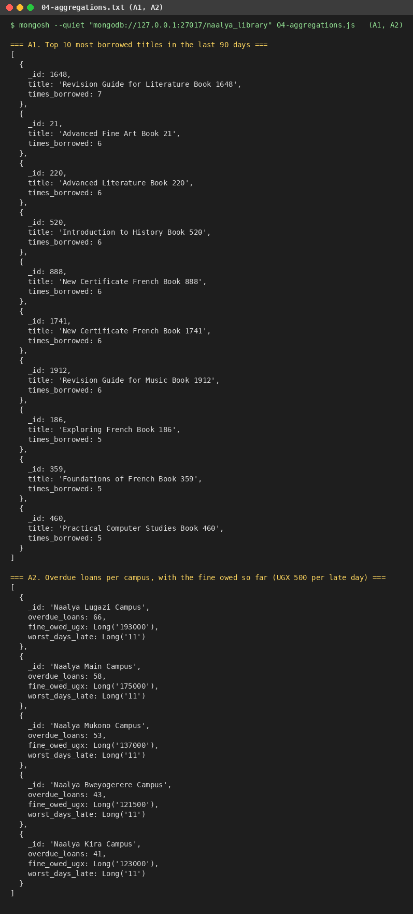
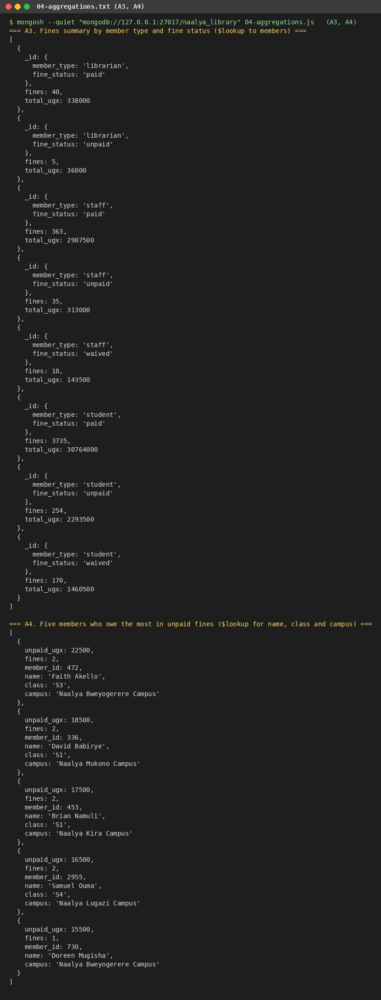
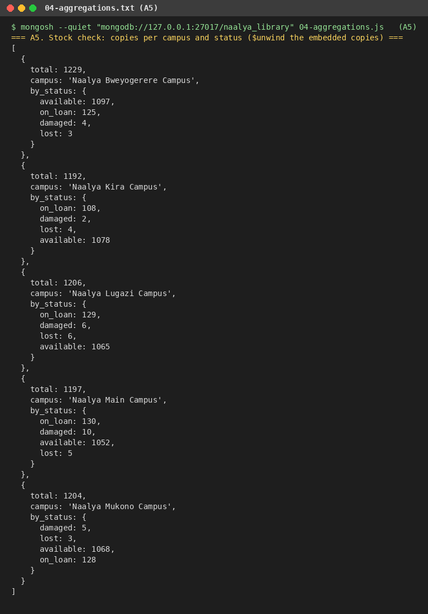
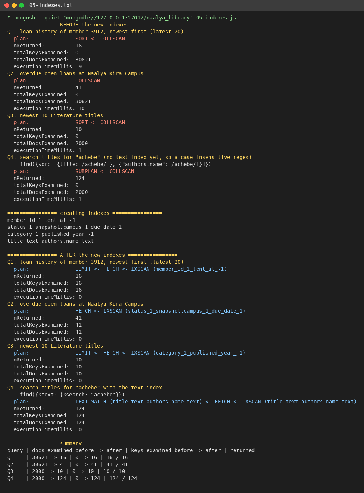
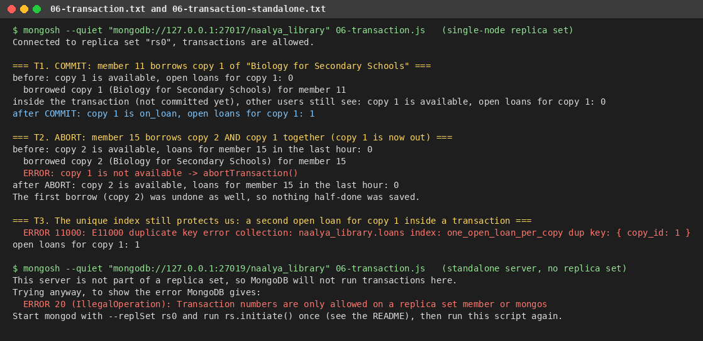

# Portfolio 4: NoSQL (MongoDB)

## 1. Goal

This part models the same Naalya Schools library in MongoDB, a document database, and
compares it with the PostgreSQL design from Part 1. It covers:

1. a document model, with reasons for what is embedded and what is referenced,
2. JSON Schema validation, with inserts that are rejected,
3. sample data (made up), CRUD queries and aggregation pipelines (reports),
4. indexes, checked with `explain('executionStats')` before and after,
5. a multi-document transaction,
6. a short SQL vs NoSQL comparison for the library.

Tested with MongoDB 7.0 and mongosh 2.x.

## 2. Files

| File | What it does |
|------|--------------|
| `01-schema.js` | Drops and recreates the `naalya_library` database, creates the 3 collections with `$jsonSchema` validators and unique indexes, then tries 5 bad inserts |
| `02-load.js` | Loads the sample data and prints one example document of each kind |
| `03-crud.js` | Create, read, update and delete examples |
| `04-aggregations.js` | Five reports built with aggregation pipelines, including `$lookup` |
| `05-indexes.js` | Four queries explained before and after adding indexes |
| `06-transaction.js` | Borrowing a book as a multi-document transaction (commit and abort) |
| `run-all.sh` | Runs all six scripts in order and saves the output in `evidence/` |
| `docker-compose.mongo.yml` | Optional: MongoDB 7 in Docker as a single-node replica set |
| `evidence/` | Real output of every script and screenshots |

## 3. Document model

Part 1 has 10 tables. In MongoDB the same data fits in 3 collections:

| Collection | One document is | Contains |
|------------|-----------------|----------|
| `titles` | one book title | ISBN, title, publisher, year, **category** (as text), **authors** (array), **copies** (array of physical copies with campus, accession number, shelf and status) |
| `members` | one member | name, email, type, class (students only), **campus** (as text), date joined |
| `loans` | one loan | `member_id`, `title_id`, `copy_id`, `lent_by` (references), dates, status, a **snapshot** (title, member name, campus at the time of the loan) and the **fine** if there is one |

Example documents (from [`evidence/02-load.txt`](evidence/02-load.txt)):

```js
// titles
{ _id: 2, isbn: '9780000000002', title: 'Things Fall Apart', publisher: 'Heinemann',
  published_year: 1958, category: 'Literature',
  authors: [ { name: 'Chinua Achebe' } ],
  copies: [ { copy_id: 4, campus: 'Naalya Kira Campus',   accession_number: 'BK-000004', shelf: 'A6',  status: 'available' },
            { copy_id: 5, campus: 'Naalya Mukono Campus', accession_number: 'BK-000005', shelf: 'B14', status: 'on_loan' },
            { copy_id: 6, campus: 'Naalya Main Campus',   accession_number: 'BK-000006', shelf: 'B1',  status: 'available' } ] }

// loans
{ member_id: 77, title_id: 72, copy_id: 214, lent_by: 900,
  lent_at: ISODate('2025-01-07T18:49:29.353Z'), due_date: ISODate('2025-01-21T18:49:29.353Z'),
  returned_at: ISODate('2025-02-10T11:33:11.721Z'), status: 'returned',
  snapshot: { title: 'New Certificate Kiswahili Book 72', member_name: 'Moses Nakato', campus: 'Naalya Lugazi Campus' },
  fine: { amount: 10000, reason: 'overdue', status: 'paid' } }
```

### Embed or reference?

The rule I followed: **embed** data that is always read together with its parent and does not
grow without limit; **reference** data that grows without limit, or is shared and changes on
its own.

| Part 1 table | MongoDB | Why |
|--------------|---------|-----|
| `category` | Embedded as a text field in `titles` | Only a name, almost never changes, always shown with the title. No join needed. |
| `author`, `book_author` | Embedded array `authors` in `titles` | A title has 1 to 3 authors, and the catalogue always shows them with the title. This removes two tables and two joins. The cost: an author's name is copied into each of their titles, so a spelling fix must update several documents. |
| `book_copy` | Embedded array `copies` in `titles` | A school holds a small, fixed number of copies of a title (1 to 5 here), so the array stays small. "Which copies of this book are free at my campus?" is answered from one document. |
| `campus` | Embedded as a text field | Only 5 campuses with fixed names; checked with an `enum` in the validator. |
| `member` | Own collection `members` | Members are shared by many loans and their details change on their own (class, campus). |
| `loan` | Own collection `loans`, **referencing** member and copy | Loans grow without limit (30,000+ here, more every term). Putting them inside members or titles would make those documents grow forever (MongoDB's limit is 16 MB per document). |
| loan → title/member names | A small **snapshot** inside each loan | Reports such as "most borrowed titles" can run on `loans` alone, without a `$lookup`. It also keeps the record as it was on the day of the loan. |
| `fine` | Embedded object `fine` inside the loan | Part 1 has a one-to-one rule (`fine.loan_id` is UNIQUE). One-to-one data that is always read with its parent is the classic case for embedding. |
| `hold` | Not modelled in this part | Would be its own collection, like loans, because holds also grow without limit. |

## 4. Validation (`01-schema.js`)

Each collection has a `$jsonSchema` validator, the MongoDB version of Part 1's NOT NULL,
CHECK and type rules:

- required fields and BSON types (`int`, `string`, `date`),
- `enum` for member type, copy status, fine status and campus names,
- a `pattern` for email and ISBN, `minimum`/`maximum` for the year, `minItems: 1` for authors,
- `anyOf` for "only students have a class" (the same rule as `chk_class_only_students`),
- `$expr` for "due date not before lent date" (the same as `chk_due_after_lent`),
- unique indexes: `members.email`, `titles.isbn`, and a **partial unique index**
  `one_open_loan_per_copy` on `loans.copy_id` where `status: 'open'`, which is the same rule as
  Part 1's `uq_one_open_loan_per_copy`.

All five bad inserts were rejected with error 121 `Document failed validation`
([`evidence/01-schema.txt`](evidence/01-schema.txt)):

| Bad insert | Rule that stopped it |
|------------|----------------------|
| Member with email `not-an-email` and type `visitor` | `email pattern`, `type enum` |
| Staff member with a class | `anyOf` |
| Loan with a fine of -500 | `fine.amount minimum` |
| Loan due before the day it was lent | `$expr {"$gte":["$due_date","$lent_at"]}` |
| Title with no authors and a campus that does not exist | `authors minItems`, `copies items` |



## 5. Sample data (`02-load.js`)

All made up (names from short lists, emails `memberN@example.com`), with a fixed random seed
so the same data comes out every time. Dates are worked out from today's date.

| Item | Count |
|------|------:|
| members | 5,000 |
| titles | 2,000 |
| copies (inside titles) | 6,028 |
| loans | 30,621 |
| open loans | 621 |
| overdue now | 261 |
| loans with a fine | 4,620 |

The load took about 1 second on the test machine.



## 6. How to run

### Option 1: Homebrew MongoDB (port 27017)

```bash
brew services start mongodb-community      # or the name shown by: brew services list
cd ~/Desktop/Umunade_Allen_301918354
mongosh --quiet "mongodb://localhost:27017/naalya_library" portfolio-4-nosql/01-schema.js
mongosh --quiet "mongodb://localhost:27017/naalya_library" portfolio-4-nosql/02-load.js
mongosh --quiet "mongodb://localhost:27017/naalya_library" portfolio-4-nosql/03-crud.js
mongosh --quiet "mongodb://localhost:27017/naalya_library" portfolio-4-nosql/04-aggregations.js
mongosh --quiet "mongodb://localhost:27017/naalya_library" portfolio-4-nosql/05-indexes.js
mongosh --quiet "mongodb://localhost:27017/naalya_library" portfolio-4-nosql/06-transaction.js
```

or all at once, saving the output in `evidence/`:

```bash
bash portfolio-4-nosql/run-all.sh
```

Run the scripts in this order. `01-schema.js` deletes the `naalya_library` database and starts
again, so the whole set can be repeated.

**Transactions need a replica set.** A normal Homebrew `mongod` runs on its own (standalone),
and `06-transaction.js` will then print MongoDB's error
`Transaction numbers are only allowed on a replica set member or mongos`
([`evidence/06-transaction-standalone.txt`](evidence/06-transaction-standalone.txt)).
To turn it into a single-node replica set, add these two lines to the Homebrew config file
(`/opt/homebrew/etc/mongod.conf` on Apple Silicon, `/usr/local/etc/mongod.conf` on Intel):

```yaml
replication:
  replSetName: rs0
```

then restart and initialise it once:

```bash
brew services restart mongodb-community
mongosh --quiet --eval 'rs.initiate({_id: "rs0", members: [{_id: 0, host: "localhost:27017"}]})'
```

Wait a few seconds until `mongosh --quiet --eval 'rs.status().members[0].stateStr'` prints
`PRIMARY`, then run the scripts as above.

### Option 2: Docker (port 27018)

`docker-compose.mongo.yml` starts `mongo:7` as a single-node replica set. It uses port 27018 so it
does not clash with Homebrew, and it does not change the root `docker-compose.yml`.

```bash
docker compose -f portfolio-4-nosql/docker-compose.mongo.yml up -d
docker exec naalya_mongo mongosh --quiet --eval 'rs.initiate({_id: "rs0", members: [{_id: 0, host: "localhost:27017"}]})'
MONGO_URI="mongodb://localhost:27018/naalya_library?directConnection=true" bash portfolio-4-nosql/run-all.sh
```

The scripts are also mounted in the container at `/scripts`, so this works without mongosh on the laptop:

```bash
docker exec naalya_mongo mongosh --quiet naalya_library /scripts/01-schema.js
```

The compose service, for reference:

```yaml
services:
  mongo:
    image: mongo:7
    container_name: naalya_mongo
    command: ["--replSet", "rs0", "--bind_ip_all"]
    ports:
      - "27018:27017"
    volumes:
      - mongodata:/data/db
      - ./:/scripts:ro
volumes:
  mongodata:
```

## 7. CRUD (`03-crud.js`)

Output: [`evidence/03-crud.txt`](evidence/03-crud.txt)

| Step | Operation | What it does |
|------|-----------|--------------|
| C1 | `insertOne` | A new student, member 5001, joins |
| C2 | `insertOne` + `updateOne` with `copies.$` | Lends copy 2 of title 1: insert the loan, then set that copy's status inside the title's `copies` array |
| R1 | `find` with a projection | Member 9's open loans, only the fields the desk needs |
| R2 | `find` with `$filter` | Only the copies of title 1 that are available at Naalya Main Campus |
| R3 | `find` on `authors.name` | Titles by Chinua Achebe (searching inside an embedded array) |
| R4 | `countDocuments` | S6 students at Naalya Kira Campus (156) |
| U1 | two `updateOne`s | Return a book: close the loan, set the copy back to `available` |
| U2 | `updateOne` on `fine.status` | Pay a fine stored inside a loan |
| U3 | `updateMany` | Move 13 History titles published before 1970 to Reference |
| D1 | `deleteOne` | Delete member 5001 **while they still have a book out**. MongoDB allows it, and a `$lookup` shows the loan now points to a member that does not exist (`member_found: 0`). PostgreSQL refuses this because of the foreign key. |
| D2 | `deleteMany` + `updateOne` | Clean up the orphan loan |

C2 and U1 each change **two** documents with two separate commands. If the second one failed,
the data would be half-updated; section 10 fixes this with a transaction.




## 8. Aggregation pipelines (`04-aggregations.js`)

Output: [`evidence/04-aggregations.txt`](evidence/04-aggregations.txt)

| Report | Pipeline | Result (test run) |
|--------|----------|-------------------|
| A1 Top 10 titles in the last 90 days | `$match` (date) → `$group` by `title_id` → `$sort` → `$limit` | Top title borrowed 7 times. No `$lookup` needed, thanks to the snapshot |
| A2 Overdue loans per campus with fine owed | `$match` (open, past due) → `$project` with `$dateDiff` → `$group` by campus → `$sort` | Lugazi 66 (UGX 193,000), Main 58 (175,000), Mukono 53 (137,000), Bweyogerere 43 (121,500), Kira 41 (123,000) |
| A3 Fines by member type and status | `$match` → **`$lookup` members** → `$unwind` → `$group` | e.g. students: 3,735 paid fines (UGX 30,764,000), 254 unpaid (UGX 2,293,500) |
| A4 Five members owing the most | `$match` unpaid → `$group` → `$sort` → `$limit` → **`$lookup` members** → `$project` | Top: member 472, Faith Akello, S3, Bweyogerere, UGX 22,500 |
| A5 Stock check per campus | `$unwind` copies → `$group` twice → `$arrayToObject` | e.g. Main Campus: 1,197 copies, 1,052 available, 130 on loan |

These reports run after `03-crud.js`, so they include its changes (for example, U2 paid one of member 3577's fines).
In A4, `$lookup` runs **after** `$limit`, so it only joins 5 documents instead of thousands.





## 9. Indexes (`05-indexes.js`)

Output: [`evidence/05-indexes.txt`](evidence/05-indexes.txt)

| Query | Index added | Plan before | Plan after | Docs examined before → after | Returned |
|-------|-------------|-------------|------------|------------------------------|---------:|
| Q1 Member 3912's loan history, newest first | `{ member_id: 1, lent_at: -1 }` (compound) | SORT ← COLLSCAN | LIMIT ← FETCH ← IXSCAN | 30,621 → 16 | 16 |
| Q2 Overdue open loans at Kira Campus | `{ status: 1, 'snapshot.campus': 1, due_date: 1 }` (compound) | COLLSCAN | FETCH ← IXSCAN | 30,621 → 41 | 41 |
| Q3 Newest 10 Literature titles | `{ category: 1, published_year: -1 }` (compound) | SORT ← COLLSCAN | LIMIT ← FETCH ← IXSCAN | 2,000 → 10 | 10 |
| Q4 Search "achebe" in titles and authors | text index `{ title: 'text', 'authors.name': 'text' }` | SUBPLAN ← COLLSCAN (regex) | TEXT_MATCH ← FETCH ← IXSCAN | 2,000 → 124 | 124 |

`executionTimeMillis` went from 9, 10, 1 and 1 ms to 0 ms for all four. The data is small, so the
times are tiny either way. The useful number is **documents examined**: without an index MongoDB
reads every document (COLLSCAN); with one it reads only the ones it returns.

Why these indexes:

- **Q1:** equality on `member_id` first, then `lent_at` in the sort order, so the results come out
  of the index already sorted (no SORT stage) and `limit(20)` can stop early.
- **Q2:** follows MongoDB's **ESR rule**: Equality fields (`status`, campus) first, then Sort,
  then Range (`due_date < now`) last.
- **Q3:** the same idea as Q1 for the catalogue.
- **Q4:** a regular expression like `/achebe/i` cannot use a normal index, but a text index
  splits titles and author names into words, so `$text: { $search: 'achebe' }` can.

As in Part 2, indexes make every insert and update a little slower and take disk space, so only
indexes for frequent queries were added.



## 10. Multi-document transaction (`06-transaction.js`)

Borrowing a book changes two documents: the copy status inside `titles` and a new document in
`loans`. Since MongoDB 4.0 these can be grouped in a transaction. Transactions need a replica set,
so the test machine ran `mongod --replSet rs0` with one member.

Output: [`evidence/06-transaction.txt`](evidence/06-transaction.txt)

| Demo | What happens | Result |
|------|--------------|--------|
| T1 commit | Member 11 borrows copy 1. Before the commit, a read from outside the session still shows copy 1 `available` with 0 open loans | After `commitTransaction()` copy 1 is `on_loan` with 1 open loan. Both changes appear together |
| T2 abort | Member 15 borrows copy 2 and then copy 1 (already out) in one transaction. The second step throws `copy 1 is not available` | After `abortTransaction()` copy 2 is still `available` and member 15 has no new loans. The first step was undone too |
| T3 unique index | A second open loan for copy 1 inside a transaction | `E11000 duplicate key error ... index: one_open_loan_per_copy` and the transaction is aborted |
| Standalone server | The same script on a mongod that is not a replica set | `ERROR 20 (IllegalOperation): Transaction numbers are only allowed on a replica set member or mongos` |

The borrow step only changes the copy if it is still available
(`copies: { $elemMatch: { copy_id, status: 'available' } }`) and checks `modifiedCount`. This works like
`SELECT ... FOR UPDATE` in Part 3: two librarians cannot both mark the same copy as on loan.



## 11. SQL (Part 1) vs NoSQL (this part)

| | PostgreSQL (Part 1) | MongoDB (Part 4) |
|---|---|---|
| Structure | 10 tables, fixed columns | 3 collections of flexible documents |
| Showing a title with authors, category and copies | Joins across 5 tables | One document read |
| Rules | NOT NULL, CHECK, UNIQUE, **foreign keys** | `$jsonSchema`, unique indexes; **no foreign keys** (D1 left an orphan loan) |
| Repeated data | None (normalised to BCNF) | Some on purpose: author names, snapshots in loans |
| Reports across entities | Joins, very flexible | `$lookup` works, but the model is designed around the main queries |
| Transactions | Always available, any number of tables | Single-document writes are atomic; multi-document transactions need a replica set |
| Scaling out | Mostly one main server (replicas for reads) | Built for sharding across servers |
| Changing the structure | `ALTER TABLE`, a migration | Add fields any time; the validator controls how strict it is |

**When each fits the library**

- **PostgreSQL** fits the core lending system: loans, returns, fines and payments. Money and stock
  must always be correct, foreign keys must stop orphan records, and the admin office runs many
  different reports that join everything.
- **MongoDB** fits the read-heavy parts: the online catalogue (one document per title, with text
  search), and data whose shape changes, such as reading logs, e-book access events or book reviews
  added later.
- A sensible plan for Naalya is to keep PostgreSQL as the main system and, if needed, copy the
  catalogue into MongoDB for fast searching.

## 12. Evidence

| File | Contents |
|------|----------|
| [`evidence/01-schema.txt`](evidence/01-schema.txt) | Collections created and the five rejected inserts |
| [`evidence/02-load.txt`](evidence/02-load.txt) | Row counts and one example document of each kind |
| [`evidence/03-crud.txt`](evidence/03-crud.txt) | All CRUD results |
| [`evidence/04-aggregations.txt`](evidence/04-aggregations.txt) | All five report results |
| [`evidence/05-indexes.txt`](evidence/05-indexes.txt) | `explain('executionStats')` summary before and after |
| [`evidence/06-transaction.txt`](evidence/06-transaction.txt) | Transaction commit, abort and unique index (replica set) |
| [`evidence/06-transaction-standalone.txt`](evidence/06-transaction-standalone.txt) | The error on a standalone server |
| `evidence/p4-*.png` | Screenshots of the output above |

**Note:** these results come from a test machine running MongoDB 7.0.48 and mongosh 2.14.2. Counts
and document examples will be the same on my laptop because the data uses a fixed seed. Times,
ObjectIds and dates will differ slightly, and the overdue numbers change a little from day to day.
