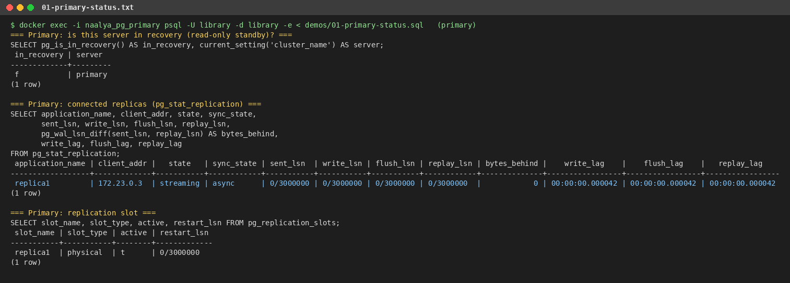
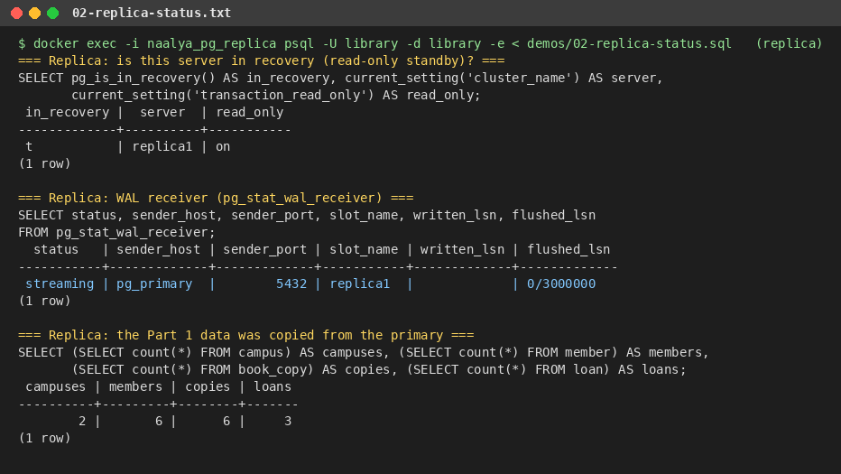
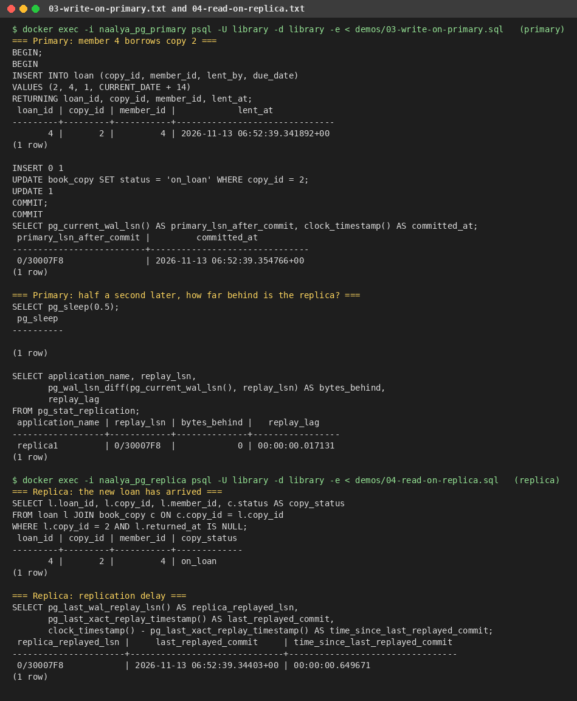
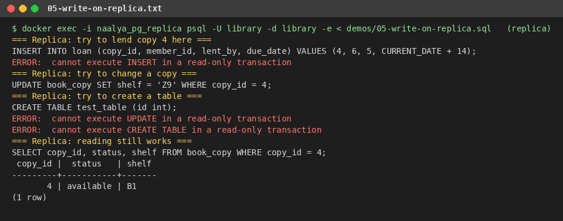
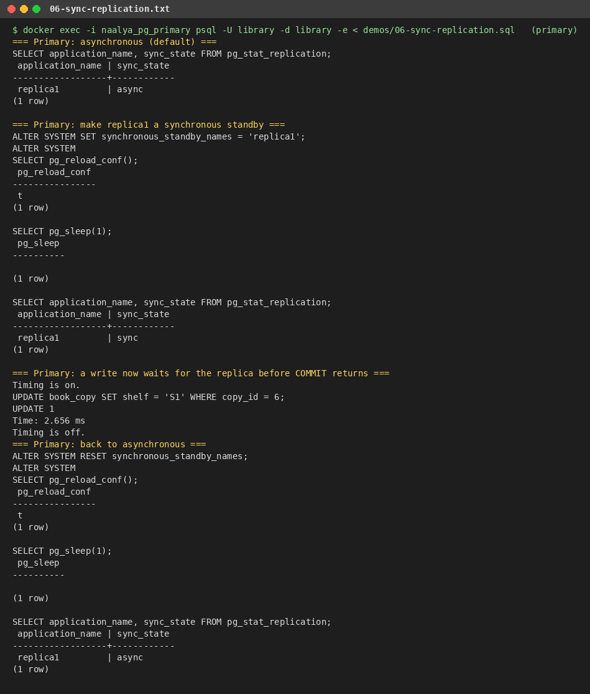
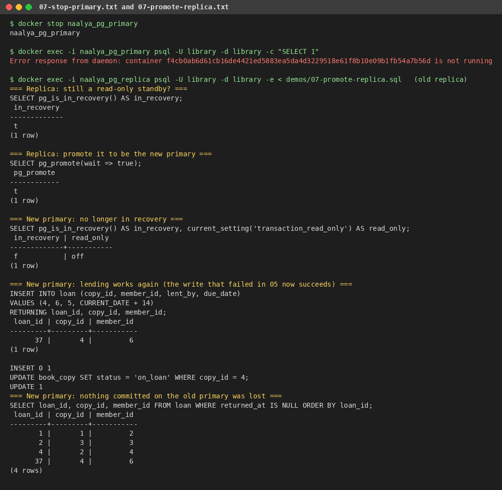
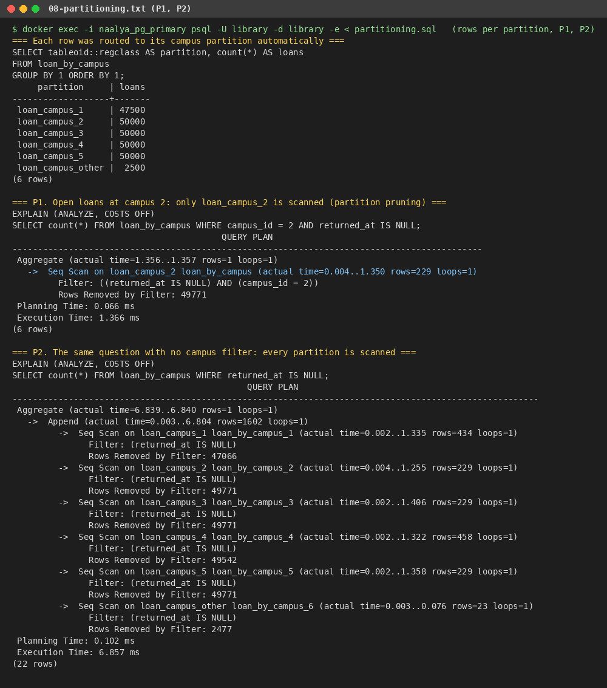
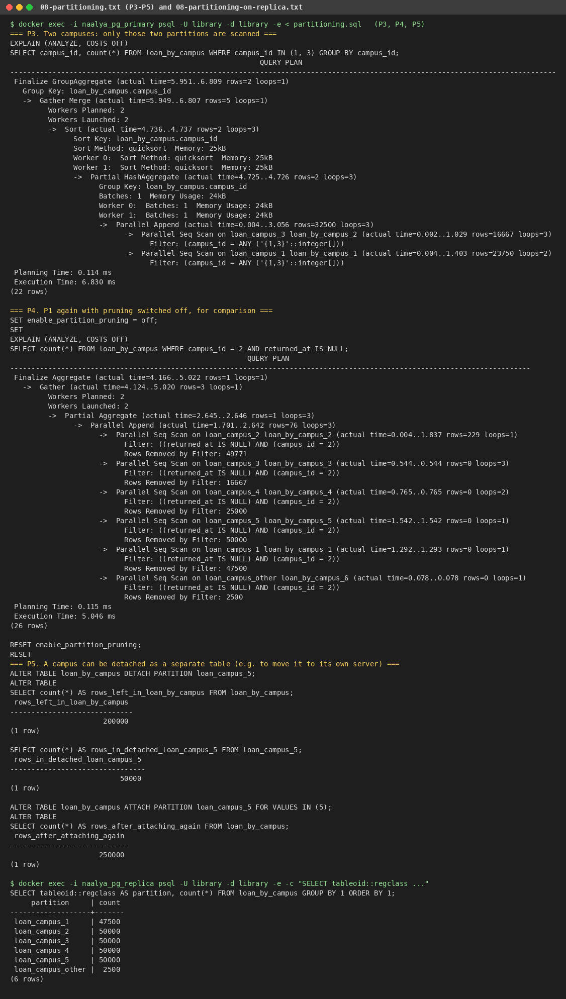
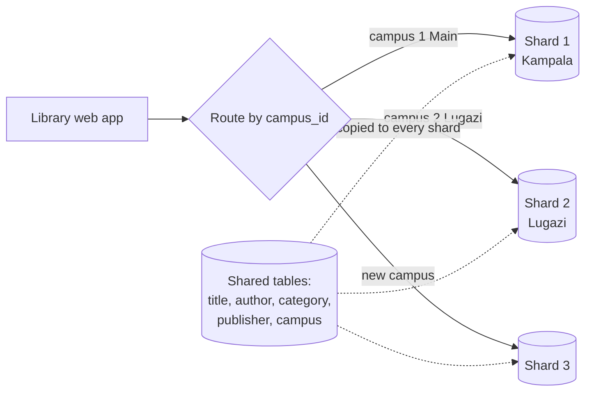
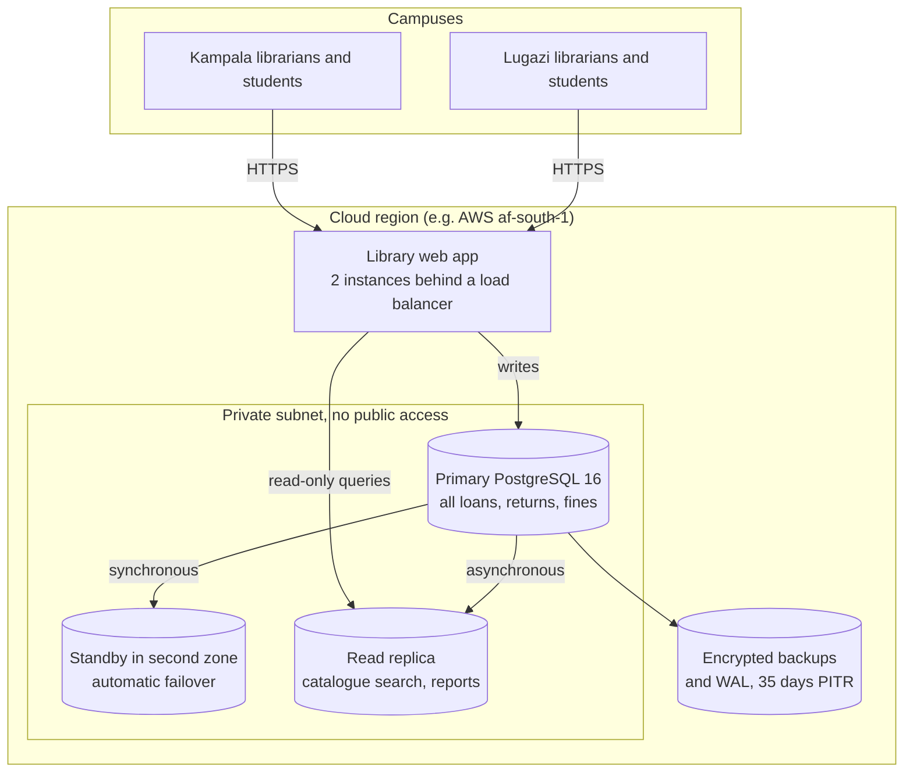

# Portfolio 5: Distributed and cloud databases

## 1. Goal

Naalya Schools has more than one campus (Main Campus in Kampala and Lugazi in Part 1, and
more could be added). This part looks at how the library database can be spread over more
than one server and run in the cloud. It covers:

1. **Replication**: a PostgreSQL 16 primary with one streaming replica (read-only copy),
   showing a write reaching the replica, replication lag, writes refused on the replica,
   synchronous vs asynchronous replication, and failover (promoting the replica).
2. **Partitioning**: the loans table split by campus with LIST partitioning, and partition
   pruning shown with `EXPLAIN`.
3. **Sharding**: how the campuses could be put on different servers (Citus or routing in
   the application).
4. **CAP theorem**: the trade-offs for a multi-campus school.
5. **Cloud**: running the database on a managed service (AWS RDS, Azure, Supabase), with
   backups, read replicas, scaling, cost and protection of student data.

All data is made up. The replication demos use the Part 1 schema and seed data; the
partitioning demo generates 250,000 synthetic loans.

## 2. Files

| File | What it does |
|------|--------------|
| `docker-compose.replication.yml` | Starts `naalya_pg_primary` (port 5434) and `naalya_pg_replica` (port 5435) with `postgres:16-alpine`. It does not change the root `docker-compose.yml` or the `library_pg` container |
| `docker/00-replication-user.sh` | Runs on the primary's first start: creates the `replicator` role and allows it in `pg_hba.conf` |
| `docker/replica-entrypoint.sh` | Runs on the replica: copies the primary with `pg_basebackup` the first time, then starts it as a read-only standby |
| `demos/01-primary-status.sql` | On the primary: connected replicas, lag, replication slot |
| `demos/02-replica-status.sql` | On the replica: is it in recovery, WAL receiver status, row counts |
| `demos/03-write-on-primary.sql` | On the primary: a member borrows a book, then the replica's lag is checked |
| `demos/04-read-on-replica.sql` | On the replica: the new loan is there, and how far behind it is |
| `demos/05-write-on-replica.sql` | On the replica: INSERT, UPDATE and CREATE TABLE are refused, SELECT works |
| `demos/06-sync-replication.sql` | On the primary: switches to synchronous replication and back |
| `demos/07-promote-replica.sql` | On the replica, after the primary is stopped: promotes it and writes to it |
| `partitioning.sql` | On the primary: `loan_by_campus` partitioned by `campus_id`, with five `EXPLAIN ANALYZE` checks |
| `run-all.sh` | Starts the two containers fresh, runs every demo in order and saves the output in `evidence/` |
| `evidence/` | Real output of every step (`.txt`) and screenshots (`.png`) |

## 3. How to run

You need Docker (Docker Desktop or OrbStack). Run these from the repository root.

### 3.1 Everything in one go

```bash
bash portfolio-5-distributed-cloud/run-all.sh
```

It removes and recreates the two replication containers (`down -v` then `up -d`), waits for
the replica, runs the demos, stops the primary, promotes the replica and writes everything to
`portfolio-5-distributed-cloud/evidence/`. Once the `postgres:16-alpine` image is downloaded it
only takes a few seconds.

### 3.2 Step by step

```bash
# start the primary and the replica (the replica copies the primary on first start)
docker compose -f portfolio-5-distributed-cloud/docker-compose.replication.yml up -d
docker logs naalya_pg_replica        # should end with "started streaming WAL from primary"

cd portfolio-5-distributed-cloud
docker exec -i naalya_pg_primary psql -U library -d library -e < demos/01-primary-status.sql
docker exec -i naalya_pg_replica psql -U library -d library -e < demos/02-replica-status.sql
docker exec -i naalya_pg_primary psql -U library -d library -e < demos/03-write-on-primary.sql
docker exec -i naalya_pg_replica psql -U library -d library -e < demos/04-read-on-replica.sql
docker exec -i naalya_pg_replica psql -U library -d library -e < demos/05-write-on-replica.sql
docker exec -i naalya_pg_primary psql -U library -d library -e < demos/06-sync-replication.sql
docker exec -i naalya_pg_primary psql -U library -d library -e < partitioning.sql

# failover: stop the primary, then promote the replica
docker stop naalya_pg_primary
docker exec -i naalya_pg_replica psql -U library -d library -e < demos/07-promote-replica.sql
```

You can also connect from the Mac with `psql -h localhost -p 5434 -U library -d library`
(primary) or `-p 5435` (replica). The password is `library`.

### 3.3 Cleaning up and running again

```bash
docker compose -f portfolio-5-distributed-cloud/docker-compose.replication.yml down -v
```

Always use `down -v` before running again. The `-v` deletes both data volumes. This matters
for two reasons:

- After the failover the old primary is behind the new one (they are on different
  timelines). It cannot just be started again as a replica; in real life you would rebuild it
  with `pg_basebackup` or use `pg_rewind`.
- The primary's data volume keeps the `replica1` replication slot. If only the replica
  volume is deleted, the new `pg_basebackup -C -S replica1` fails because the slot already
  exists.

### 3.4 Where this was tested

The evidence in `evidence/` was captured on my laptop (Docker with OrbStack) using the compose
setup above, by running `bash portfolio-5-distributed-cloud/run-all.sh`. Every demo used the
`docker exec` and `docker stop` commands shown in 3.2. If you run it again the LSNs, timings
and timestamps will be a little different. Timestamps in the output are in UTC, because that
is the time zone inside the containers.

## 4. Replication

### 4.1 How it is set up

Streaming replication copies the primary's write-ahead log (WAL) to the replica as it is
written, and the replica replays it, so the replica holds the same data.

- The primary runs with `wal_level=replica` and allows up to 5 WAL senders.
- `00-replication-user.sh` creates a `replicator` role with the `REPLICATION` right and
  adds a `pg_hba.conf` line so it can connect for replication.
- On first start the replica runs `pg_basebackup`, which copies the whole primary.
  `-R` writes `standby.signal` and the connection details, so the copy starts as a
  standby. `-C -S replica1` creates a replication slot so the primary keeps any WAL the
  replica has not received yet. `-c fast` makes the primary checkpoint straight away (without
  it the copy can wait minutes for a normal checkpoint).
- `cluster_name=replica1` is the name the replica shows on the primary, and the name used
  for synchronous replication.

### 4.2 Replica connected (01, 02)

`01-primary-status.txt` (on the primary):

```
 application_name | client_addr |   state   | sync_state | sent_lsn  | ... | replay_lsn | bytes_behind |    write_lag    | ...
 replica1         | 172.23.0.3  | streaming | async      | 0/3000000 | ... | 0/3000000  |            0 | 00:00:00.000042 | ...
```

The replica is streaming, it has replayed everything (`bytes_behind` is 0), and the slot
`replica1` is active. `02-replica-status.txt` shows the replica has
`pg_is_in_recovery() = t` and `transaction_read_only = on`, its WAL receiver is
`streaming` from `pg_primary` (the primary's name on the Docker network), and it already has the Part 1 seed data (2 campuses,
6 members, 6 copies, 3 loans) without the seed ever being run on it.




### 4.3 A write on the primary appears on the replica, and the lag (03, 04)

On the primary, member 4 borrows copy 2 in one transaction (insert the loan, mark the copy
`on_loan`). This created loan 4 and the primary's WAL position after the commit was
`0/30007F8`. Half a second later `pg_stat_replication` showed:

```
 application_name | replay_lsn | bytes_behind |   replay_lag
 replica1         | 0/30007F8  |            0 | 00:00:00.017131
```

On the replica, loan 4 is there and copy 2 shows `on_loan`. The replica's replayed position
is also `0/30007F8`, the same as the primary:

```
 replica_replayed_lsn |     last_replayed_commit      | time_since_last_replayed_commit
 0/30007F8            | 2026-11-13 06:52:39.34403+00 | 00:00:00.649671
```

So the change was replayed on the replica about 17 ms after it was written
(`replay_lag`). `time_since_last_replayed_commit` (0.65 s) is not the lag itself: it is the
time since the last commit that was replayed, and it includes the half second the script
waited. It only grows like this because nothing else was being written; on a busy system it
is a quick way to see if a replica has fallen behind.



### 4.4 Writes on the replica are refused (05)

```
ERROR:  cannot execute INSERT in a read-only transaction
ERROR:  cannot execute UPDATE in a read-only transaction
ERROR:  cannot execute CREATE TABLE in a read-only transaction
```

The `SELECT` in the same script still works. This is why a replica is used for reading
(reports, the online catalogue search) while all lending and returns go to the primary.



### 4.5 Synchronous vs asynchronous (06)

By default the replica is `async`: the primary says COMMIT is done as soon as its own WAL is
on disk and does not wait for the replica. The script then runs:

```sql
ALTER SYSTEM SET synchronous_standby_names = 'replica1';
SELECT pg_reload_conf();
```

after which `sync_state` changed from `async` to `sync`. An `UPDATE` on `book_copy` then took
**2.656 ms**, and that time includes waiting for the replica to confirm it had written the
change to disk. Finally the setting is reset and `sync_state` went back to `async`.

| | Asynchronous (default) | Synchronous |
|---|---|---|
| COMMIT waits for | the primary's disk only | the primary and the replica |
| Speed of writes | fastest | slower, by the network round trip to the replica |
| If the primary dies | the last few transactions that had not reached the replica can be lost | nothing committed is lost |
| If the replica dies | primary carries on | writes on the primary **wait** until the replica comes back or the setting is changed |

Here the replica is on the same machine, so the extra wait is tiny. If the replica was at
the Lugazi campus over a slow link, every loan would wait for that link. For the library,
asynchronous is a good default: losing the last second of loans in a crash is a small risk
compared with lending stopping every time the link between campuses drops. Synchronous is
worth it for data that must never be lost, such as fines payments, and PostgreSQL even lets
you choose per transaction (`SET synchronous_commit = off` or `on`).



### 4.6 Failover: stop the primary, promote the replica (07)

The primary container is stopped with `docker stop`, and a `docker exec` into it then fails
with `Error response from daemon: container ... is not running`. On the
replica, `pg_promote(wait => true)` returns `t`, after which `pg_is_in_recovery()` is `f` and
`transaction_read_only` is `off`. The same kind of INSERT that was refused in step 05 now
works: copy 4 is lent to member 6. The open loans list shows loans 1, 2 and 4 (loan 4 was
made on the old primary in step 03), so nothing that had reached the replica was lost.

The new loan got `loan_id` **37**, not 5. This is normal: PostgreSQL writes sequence values
to the WAL 32 at a time, so the replica only knows the sequence had reached the end of that
block. After a failover the ids jump, but they never repeat. Ids should never be expected to
have no gaps anyway.

In this demo the failover was done by hand. In production a tool such as Patroni (or the
cloud provider, see section 8) watches the primary and promotes a replica automatically,
and the application connects through one address that is moved to the new primary.



## 5. Partitioning by campus

`partitioning.sql` creates `loan_by_campus`, a copy of the loan table with a `campus_id`
column, split by `LIST (campus_id)`:

```sql
CREATE TABLE loan_by_campus ( ... campus_id INT NOT NULL, ... PRIMARY KEY (loan_id, campus_id))
PARTITION BY LIST (campus_id);
CREATE TABLE loan_campus_1     PARTITION OF loan_by_campus FOR VALUES IN (1);
...
CREATE TABLE loan_campus_5     PARTITION OF loan_by_campus FOR VALUES IN (5);
CREATE TABLE loan_campus_other PARTITION OF loan_by_campus DEFAULT;
```

It is a separate demo table so the Part 1 `loan` table is not changed. The primary key has to
include `campus_id` because PostgreSQL can only enforce uniqueness inside each partition.
250,000 synthetic loans were inserted into the parent table and PostgreSQL put each row in
the right partition by itself:

| Partition | Rows |
|-----------|------|
| loan_campus_1 | 47,500 |
| loan_campus_2 | 50,000 |
| loan_campus_3 | 50,000 |
| loan_campus_4 | 50,000 |
| loan_campus_5 | 50,000 |
| loan_campus_other (DEFAULT) | 2,500 |

The 2,500 rows in the default partition have `campus_id = 6`, a campus with no partition
yet. Without a DEFAULT partition those inserts would fail.

### Partition pruning (EXPLAIN ANALYZE)

| Query | Partitions scanned | Execution time |
|-------|--------------------|----------------|
| P1. Open loans at campus 2 | only `loan_campus_2` | 1.366 ms |
| P2. Open loans, no campus filter | all 6 | 6.857 ms |
| P3. Loans at campus 1 and 3 (`IN (1, 3)`) | only `loan_campus_1` and `loan_campus_3` | 6.830 ms |
| P4. P1 with `enable_partition_pruning = off` | all 6 | 5.046 ms |

In P1 the plan has a single `Seq Scan on loan_campus_2`; the other five partitions are not
even in the plan. With pruning turned off (P4) the same query scans all six partitions and
finds no matching rows in five of them. It was helped by two parallel workers and still took
over three times as long. P3 counts about 97,500 rows, so it takes longer than P1, but it
still only reads two partitions.

P5 shows another benefit: `ALTER TABLE ... DETACH PARTITION loan_campus_5` removes a whole
campus from the table instantly (the table went from 250,000 to 200,000 rows and
`loan_campus_5` stayed as a normal table with its 50,000 rows), and `ATTACH PARTITION` puts it
back. This is how old years or a campus could be archived or moved without a slow `DELETE`.

The partitioned table was also checked on the replica (`08-partitioning-on-replica.txt`):
the same six partitions and row counts were there, because the `CREATE TABLE` and the
inserts were replicated like any other change.




**Partitioning vs sharding:** all the partitions above are still on one server. Partitioning
makes big tables easier to manage and lets queries skip data, but it does not add more CPU,
memory or disk. Sharding does.

## 6. Sharding by campus (explanation)

Sharding means putting different rows on different servers. For Naalya the natural
**shard key** is `campus_id`: almost every lending action (borrow, return, the campus
librarian's reports) is about one campus.



**Option A: Citus** (a PostgreSQL extension). A coordinator node holds the table
definitions and worker nodes hold the data:

```sql
SELECT create_distributed_table('member',    'campus_id');
SELECT create_distributed_table('book_copy', 'campus_id');
SELECT create_distributed_table('loan',      'campus_id');   -- loan needs a campus_id column
SELECT create_reference_table('title');                      -- small, copied to every worker
SELECT create_reference_table('category');
```

The application still connects to one database. A query with `WHERE campus_id = 2` is sent
only to the worker holding campus 2, and a report across all campuses is run on every worker
in parallel and combined by the coordinator. Tables distributed on the same column are
"co-located", so joins of `loan`, `member` and `book_copy` for one campus stay on one worker.
To make this work `loan` would need its own `campus_id` column (in Part 1 it gets the campus
through `book_copy`).

**Option B: routing in the application.** Each campus has its own normal PostgreSQL database
with the Part 1 schema. The application has a small map (campus 1 → server A,
campus 2 → server B) and opens the connection for the campus of the logged-in librarian.
This is simple and each campus can keep working on its own, but cross-campus reports must
query each server and add the results in code, and the shared catalogue (`title`, `author`)
must be kept the same on every server.

**Problems sharding brings, for either option:**

- A student who borrows at another campus touches two shards, so that loan needs a
  distributed transaction or a rule that the loan is stored at the copy's campus.
- Unique rules across all campuses (for example a student email) can no longer be checked
  by one index.
- Moving a campus to another shard (rebalancing) takes planning.

For two or three campuses the data is small enough for one server; replication (section 4)
plus partitioning (section 5) is enough. Sharding only becomes worth the extra work with many
campuses or when each campus must keep working even when it cannot reach the others.

## 7. CAP theorem for a multi-campus school

CAP says that when there is a **network partition** (the link between servers is broken), a
distributed database has to choose between **Consistency** (every read sees the latest
write) and **Availability** (every request gets an answer). It cannot have both until the
link is back.

Suppose the Lugazi campus has a replica or shard and the internet link to Kampala goes down:

| Choice | What happens at Lugazi during the outage | Risk |
|--------|-------------------------------------------|------|
| **CP** (consistency first) | Lending at Lugazi stops, or only reading the catalogue works, until the link is back | Students cannot borrow for hours |
| **AP** (availability first) | Lugazi keeps lending on its own copy of the data and the two sides are merged later | The same copy or the same member's borrowing limit can be used on both sides, so conflicts must be fixed after |

How this applies to the library:

- **Loans, returns and fines** should be **consistent**: a copy must not be lent twice, and
  money must be right. With PostgreSQL replication there is only one primary, so it is CP for
  writes: if a campus cannot reach the primary it cannot record loans.
- **The catalogue search** (titles, authors, where a copy is) can be **available** and a bit
  out of date. A replica at each campus can keep answering searches during an outage, and
  showing a copy as available a few seconds late does not do much harm.
- Sharding by campus (section 6) reduces the problem: each campus's loans live at that campus,
  so a broken link only affects borrowing at another campus and cross-campus reports, not
  normal lending.
- When there is no partition, the trade-off is between **latency and consistency**
  (sometimes called PACELC). That is the sync vs async choice in section 4.5.

## 8. Cloud deployment

### 8.1 Managed PostgreSQL options

Instead of running the servers ourselves, the school could use a managed PostgreSQL service,
where the provider installs, patches, backs up and monitors the server.

| | AWS RDS for PostgreSQL | Azure Database for PostgreSQL (Flexible Server) | Supabase |
|---|---|---|---|
| Nearest region to Uganda | Africa (Cape Town), `af-south-1` | South Africa North (Johannesburg) | chosen when the project is created; check the list for an African region |
| Automatic backups | daily snapshots + transaction logs, kept 1 to 35 days, restore to any second (point-in-time recovery) | kept 7 to 35 days, point-in-time restore | daily backups; point-in-time recovery is an extra on paid plans |
| High availability | Multi-AZ: a standby in another data centre with automatic failover | zone-redundant standby with automatic failover | depends on the plan |
| Read replicas | yes, also in another region | yes | yes, on paid plans |
| Scaling | change the instance size (short restart), storage can grow automatically | change compute size, storage grows | change compute size |
| Extras | IAM login, KMS encryption | Entra ID login, encryption | built-in API, login and storage for a web app |

Prices change and depend on region, size and storage, so they should be checked with each
provider's pricing calculator before choosing. The main cost items are the same everywhere:
the instance size (paid per hour), storage, backup storage beyond the free amount, each read
replica (a full second instance), a Multi-AZ standby (roughly doubles the instance cost) and
data transferred out. For a school library a small instance is enough; reserved (1 year)
pricing and turning off test databases at night reduce the bill.

### 8.2 Proposed architecture



- All writes go to the primary. The standby in another availability zone gets the WAL
  synchronously and takes over automatically if the primary's zone fails, like the manual
  `pg_promote` in section 4.6.
- Catalogue search and reports are sent to the read replica, so heavy end-of-term reports
  do not slow down lending. It is asynchronous, which is fine for reads (section 4.5).
- Backups plus point-in-time recovery cover mistakes that replication cannot fix: if someone
  deletes loans by accident, the delete is copied to every replica straight away, but a
  restore to one minute before it brings the data back.
- **Scaling:** first scale up (bigger instance), then add read replicas for more reads.
  Partitioning the loans table by campus or year (section 5) keeps it fast as it grows. If
  many more campuses join, the database could move to sharding with Citus (section 6),
  run on cloud servers.

### 8.3 Protecting student data

The library holds personal data about students, most of whom are children: names, emails,
classes and what they borrow.

- **Law:** Uganda's Data Protection and Privacy Act, 2019 applies. The school must collect
  only the data it needs, keep it secure, and register with the Personal Data Protection
  Office. Processing data about children needs the consent of a parent or guardian, and the
  Act limits storing personal data outside Uganda unless the other country gives adequate
  protection or the person consents. Since none of the big providers has a region in Uganda,
  the school would need to check this (and the contract with the provider) before choosing a
  region such as Cape Town or Johannesburg.
- **Encryption:** turn on storage encryption (it also covers backups and replicas) and force
  SSL/TLS for every connection (`rds.force_ssl` on RDS, `require_secure_transport` on Azure).
- **Network:** put the database in a private subnet with no public IP; only the web app's
  security group can reach port 5432.
- **Access:** separate roles: the app's role can only do what the app needs, librarians do
  not get direct database logins, and report users only get the read replica. Use cloud
  identity login (IAM or Entra ID) and a secrets manager instead of passwords in code.
  Row-level security can stop a librarian at one campus seeing another campus's members.
- **Data minimisation:** keep only what is needed (no home address or phone for students if
  the library does not need it) and delete or anonymise loan history after a set time, for
  example when a student leaves.
- **Auditing and testing:** turn on logging of logins and changes (for example `pgaudit`),
  and use made-up data, like in this portfolio, for development and testing, never a copy of
  the real student records.

## 9. Evidence

| File | Contents |
|------|----------|
| `00-start.txt` | `docker compose up` messages (network, volumes, containers, primary healthy) |
| `01-primary-status.txt` | Replica streaming, lag, slot (primary) |
| `02-replica-status.txt` | Recovery mode, WAL receiver, seed data counts (replica) |
| `03-write-on-primary.txt` | Loan 4 created, WAL position, lag half a second later |
| `04-read-on-replica.txt` | Loan 4 on the replica, replayed position and time |
| `05-write-on-replica.txt` | INSERT, UPDATE and CREATE TABLE refused on the replica |
| `06-sync-replication.txt` | async → sync → async, timed UPDATE |
| `07-stop-primary.txt` | Primary container stopped, then `docker exec` into it fails |
| `07-promote-replica.txt` | Promotion, new loan 37, open loans |
| `08-partitioning.txt` | Partition row counts and P1 to P5 plans |
| `08-partitioning-on-replica.txt` | Partition row counts on the replica |
| `p5-*.png` | Screenshots of the files above |
